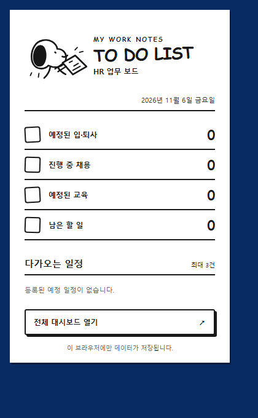

# HR 업무 보드

## 한 줄 소개

입·퇴사 일정, 채용, 교육, 할 일을 한 화면에서 살펴보고 관리하는 크롬 확장 프로그램입니다.

## 누구를 위해 만들었나요

여러 종류의 인사 업무와 오늘 할 일을 함께 확인하고 싶은 사람을 위해 만들었습니다.

## 주요 기능

- 팝업에서 예정된 입·퇴사와 교육, 진행 중 채용, 남은 할 일의 건수를 확인합니다.
- 전체 대시보드에서 항목을 등록·수정·삭제하고 검색하거나 상태별로 걸러 봅니다.
- 채용 충원 인원과 교육 참석·불참 인원을 기록합니다.

## 화면

## 강사 예시에서 바꾼 점

- 기본 할 일 작성기를 입·퇴사, 채용, 교육까지 살펴볼 수 있는 업무 보드로 확장했습니다.
- 팝업에는 요약을, 전체 대시보드에는 상세 목록과 입력 화면을 배치했습니다.

## 써 보는 법

1. 크롬의 `chrome://extensions`에서 개발자 모드를 켜고 이 폴더를 압축해제된 확장 프로그램으로 불러옵니다.
2. 확장 프로그램 아이콘을 눌러 요약을 확인한 뒤 **전체 대시보드 열기**를 누릅니다.
3. 왼쪽 메뉴에서 항목 종류를 고르고 **새 항목 등록**으로 내용을 입력합니다.

## 다음에 붙이고 싶은 기능

- 다가오는 일정과 할 일의 알림 기능

## 만들면서 배운 점

팝업에는 핵심 숫자를 모으고, 상세 입력과 수정은 별도 대시보드에 배치하면 여러 업무를 더 쉽게 살펴볼 수 있습니다. 입력한 항목은 브라우저의 로컬 저장소에 보관됩니다.
