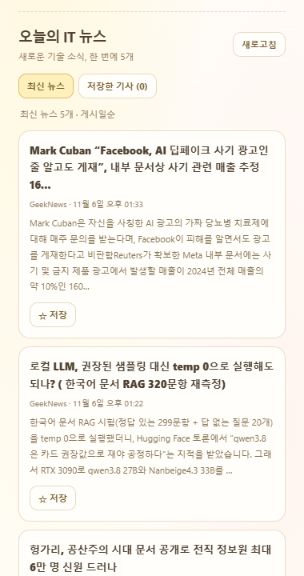

# 오늘 할 일 작성기

## 한 줄 소개

우사기와 함께 할 일을 정리하고 서울 날씨와 최신 IT 뉴스 5개를 확인하는 크롬 확장프로그램입니다.

## 누구를 위해 만들었나요

오늘 해야 할 일을 관리하면서 새로운 기술과 IT 소식을 업무에 참고하고 싶은 사람을 위해 만들었습니다.

## 주요 기능

- 할 일을 추가·완료·삭제하고 남은 개수를 확인합니다. 할 일은 브라우저에 저장됩니다.
- Open-Meteo로 서울의 현재 기온과 날씨를 확인합니다. 로딩 중과 실패 시 안내 문구를 표시합니다.
- GeekNews RSS에서 최신 IT 뉴스 최대 5개를 가져와 게시일순으로 표시합니다. 원문을 열거나 기사를 저장·저장 해제할 수 있습니다.

## 화면

## 강사 예시에서 바꾼 점

- 우사기 캐릭터와 따뜻한 색상으로 화면을 꾸몄습니다.
- 오른쪽 상단에 서울 날씨를 아이콘과 기온으로 간결하게 표시합니다. 마우스를 올리면 자세한 날씨와 제공처를 확인할 수 있습니다.
- 할 일 목록 아래에 최신 IT 뉴스, 새로고침, 저장한 기사 보기를 추가했습니다.
- 뉴스 접근 권한이 없으면 권한 요청 버튼을 표시하고, 이전 설정을 사용 중이면 확장프로그램 다시 시작을 안내합니다.

## 써 보는 법

1. 크롬에서 `chrome://extensions`를 열고 개발자 모드를 켠 뒤, **압축해제된 확장 프로그램을 로드합니다**로 이 폴더를 선택합니다.
2. 팝업에서 할 일을 입력하고 **추가**를 누릅니다. 체크박스로 완료 표시를 하고 ×로 삭제합니다.
3. 아래로 스크롤해 뉴스를 확인합니다. 제목으로 기사 페이지를 열고 **☆ 저장**으로 스크랩합니다. 뉴스 접근 권한 안내가 나오면 **뉴스 접근 허용**을 누릅니다. **확장 다시 시작**이 나오면 누른 뒤 팝업을 다시 엽니다.

## 다음에 붙이고 싶은 기능

- 관심 분야를 선택해 AI·개발·보안 뉴스를 골라 보기

## 만들면서 배운 점

확장프로그램에서 외부 API와 RSS를 가져오려면 해당 주소에 대한 접근 권한이 필요합니다. 파일의 manifest 설정과 현재 크롬에 적용된 권한이 다를 수 있어, 권한 확인과 요청·다시 시작 안내를 추가했습니다.

기사 소개는 RSS 제공 내용의 앞부분이며 별도 AI 요약은 아닙니다. 로그인이나 API 키 없이 사용할 수 있고, 할 일과 저장한 기사는 브라우저 로컬 저장소에 보관됩니다.
