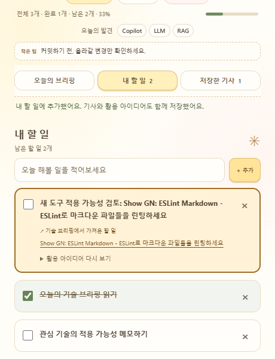

# 우사기 테크 브리핑 2.0
## 한 줄 소개
오늘의 기술을 내 업무에 연결하다. 개발자와 IT 종사자를 위한 데일리 기술 브리핑 & 스마트 투두입니다.

## 누구를 위해 만들었나요
새로운 기술을 꾸준히 확인하고, 활용 아이디어를 실제 업무로 연결하고 싶은 개발자와 IT 종사자를 위해 만들었습니다.

## 주요 기능
- 오늘의 브리핑 / 내 할 일 / 저장한 기사 탭과 실제 데이터에 반응하는 대시보드
- 서울 시간 오늘 GeekNews에 등록된 기술 소식 최대 5개, 카테고리·제목·소개·원문·스크랩
- 활용 목적·중요성·적용 환경과 3단계 활용 아이디어, 기사와 아이디어가 연결된 할 일
- 할 일 추가·완료·삭제, 중복 방지, 저장한 기사 보관, 서울 날씨
- 제목에서 추출한 최대 3개 기술 키워드와 필터, 매일 바뀌는 공식 문서 기반 로컬 개발 팁

## 화면

별도 테스트 프로필의 예제 할 일로 촬영했습니다. 뉴스와 날씨는 촬영 시 실제 API 응답입니다.

## 강사 예시에서 바꾼 점
- 기존 우사기 에셋과 크림색 테마를 재사용하고 큰 우사기·말풍선·낙서와 작은 정보 표시·책갈피 탭·내부 스크롤로 구성했습니다.
- RSS를 날짜·주제·중복 기준으로 선별하고, 기사에서 활용 아이디어를 확인한 뒤 할 일로 옮기는 흐름을 추가했습니다.
- 저장 실패 시 기존 데이터를 유지하고, 오래된 형식의 할 일과 스크랩도 읽을 수 있도록 했습니다.
- 할 일 완료율은 현재 보관 중인 전체 할 일 기준입니다. 날짜 필드가 없는 기존 할 일도 포함하며 자정에 삭제하지 않습니다.

## 써 보는 법
1. Chrome에서 `chrome://extensions`를 열고 기존 확장프로그램의 새로고침(↻)을 누른 뒤 팝업을 다시 엽니다. 처음 설치한다면 개발자 모드에서 이 폴더를 압축해제된 확장프로그램으로 로드합니다.
2. 브리핑의 **활용 아이디어 보기**를 펼쳐 내용을 확인하고 **내 할 일에 추가**를 누릅니다. 할 일 탭에서 출처와 아이디어를 다시 확인하고 완료 처리할 수 있습니다.
3. 별표로 기사를 저장하고 **저장한 기사** 탭에서 확인합니다. 대시보드 키워드를 누르면 해당 기사를 필터링하며 다시 누르면 해제됩니다.
4. 권한 안내가 나오면 뉴스 접근을 허용합니다. 이전 manifest를 사용 중이라는 안내가 나오면 **확장 다시 시작** 후 다시 엽니다.

## 다음에 붙이고 싶은 기능
- 사용자가 직접 관심 기술과 직무를 설정하는 맞춤 브리핑
- 할 일별 활용 후기·메모, 데이터 내보내기와 가져오기

## 만들면서 배운 점
뉴스 탐색과 실행을 연결하려면 출처·활용 아이디어를 할 일과 함께 저장해야 합니다. 기존 저장소 키를 유지하고 선택적인 새 필드만 추가하면 이전 데이터를 지키면서 기능을 확장할 수 있습니다.

뉴스의 오늘은 기술 출시일이 아닌 GeekNews 게시일입니다. 피드에 포함된 기사만 키워드로 선별하므로 오분류·누락이 있을 수 있습니다. 활용 아이디어는 제목·분야에 따른 일반 템플릿이며 AI 원문 분석이나 기능 검증 결과가 아닙니다. API 키·로그인·백엔드는 필요하지 않습니다.

뉴스는 팝업 열기·수동 새로고침·열려 있는 동안 15분마다 갱신합니다. 마지막 정상 확인 시각을 표시하고, 날짜가 바뀌면 지난 기사를 오늘 목록에서 제외합니다. 저장한 기사는 날짜와 무관하게 보관합니다.

구현 구조, 데이터 호환성, 테스트 재현 방법과 제한은 [구현·검증 기록](IMPLEMENTATION.md)을 참고하세요.
