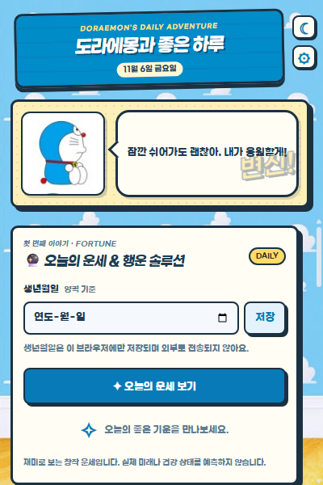
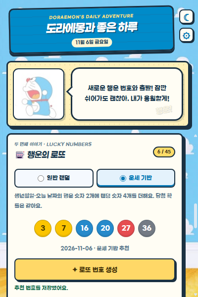
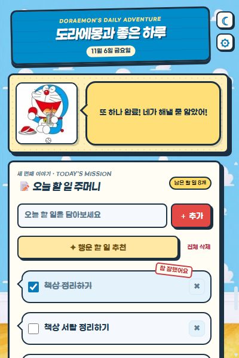

# 도라에몽과 좋은 하루 · 대시보드

## 한 줄 소개

도라에몽의 응원과 함께 오늘의 운세, 행운의 로또 번호, 할 일을 한 화면에서 확인하는 크롬 확장프로그램입니다.

## 누구를 위해 만들었나요

아침에 가볍게 하루를 시작하고, 오늘 할 일을 정리하면서 재미있는 응원도 받고 싶은 사람을 위해 만들었습니다.

## 주요 기능

- 생년월일을 저장하면 총운·금전운·애정운·건강운과 추천 행동·행운 색상·복장을 확인할 수 있습니다.
- 일반 랜덤·운세 기반 로또 번호를 생성하고, 최신·과거 회차의 당첨 번호와 비교할 수 있습니다.
- 할 일 추가·추천·완료·삭제, 도라에몽 그림 랜덤 전환, 말풍선 응원과 완료 효과를 제공합니다.

## 화면

## 강사 예시에서 바꾼 점

- 할 일 작성기에 운세·행운 솔루션과 로또 추천·당첨 조회 기능을 추가했습니다.
- 세 기능을 탭 대신 하나의 세로 스크롤 대시보드로 통합했습니다.
- 우디 예시의 구름 배경·만화 컷·간판·글꼴을 도라에몽 테마로 재구성했습니다.
- 첨부한 이미지의 16개 도라에몽을 그림 클릭으로 바꿀 수 있게 만들었습니다.
- 도라에몽과 말풍선을 고정하여 아래 목록을 볼 때에도 응원이 보이도록 했습니다.
- 다크·라이트 테마, 크기 조절 가능한 큰 창, 할 일 JSON 내보내기·가져오기를 추가했습니다.

## 써 보는 법

1. 크롬에서 `chrome://extensions`를 열고 개발자 모드를 켠 뒤, **압축해제된 확장 프로그램 로드**에서 이 `MINJUN-B` 폴더를 선택합니다. `manifest.json`이 이 폴더 바로 안에 있어야 합니다.
2. 확장프로그램 아이콘을 눌러 생년월일을 저장하고 운세를 보거나, 아래로 스크롤해 로또와 할 일을 사용합니다. 도라에몽 그림을 누르면 다른 그림으로 바뀝니다.
3. 오른쪽 위 설정에서 큰 창을 열거나 할 일을 내보내고 가져옵니다. 해·달 버튼으로 테마를 바꿉니다.

생년월일과 할 일은 `chrome.storage.local`에 저장하며 외부로 전송하지 않습니다. 이미지·글꼴은 확장프로그램 안에 포함되어 있습니다. 스크린샷의 입력값과 할 일은 기능 시연용 예시입니다.

운세와 번호 추천은 오락용이며 미래나 당첨을 예측하지 않습니다. 당첨 번호는 비공식 공개 데이터인 [lotto-api](https://visionary153.github.io/lotto-api/)와 [smok95/lotto](https://github.com/smok95/lotto)를 조회합니다. 오류·갱신 지연이 있을 수 있으므로 실제 당첨은 [동행복권](https://www.dhlottery.co.kr/)에서 확인하세요.

## 다음에 붙이고 싶은 기능

- 완료한 할 일을 날짜별로 돌아보는 기록 화면과 주간 달성률을 추가하고 싶습니다.

## 만들면서 배운 점

캐릭터 영역과 스크롤 영역을 분리해야 작은 팝업에서도 중요한 화면이 계속 보인다는 것을 배웠습니다. 외부 API 조회에는 오류 처리와 캐시가 필요하고, 저장 성공 후에 완료 효과를 보여줘야 화면과 실제 데이터가 일치한다는 점도 배웠습니다.

로컬 글꼴의 출처와 라이선스는 `fonts/LICENSE.txt`, 이미지 출처는 `assets/sources.json`에 포함했습니다.
