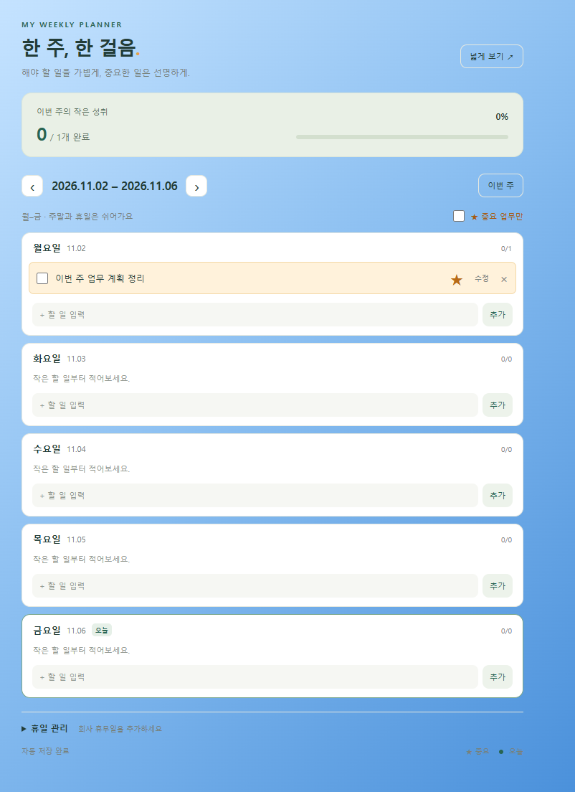
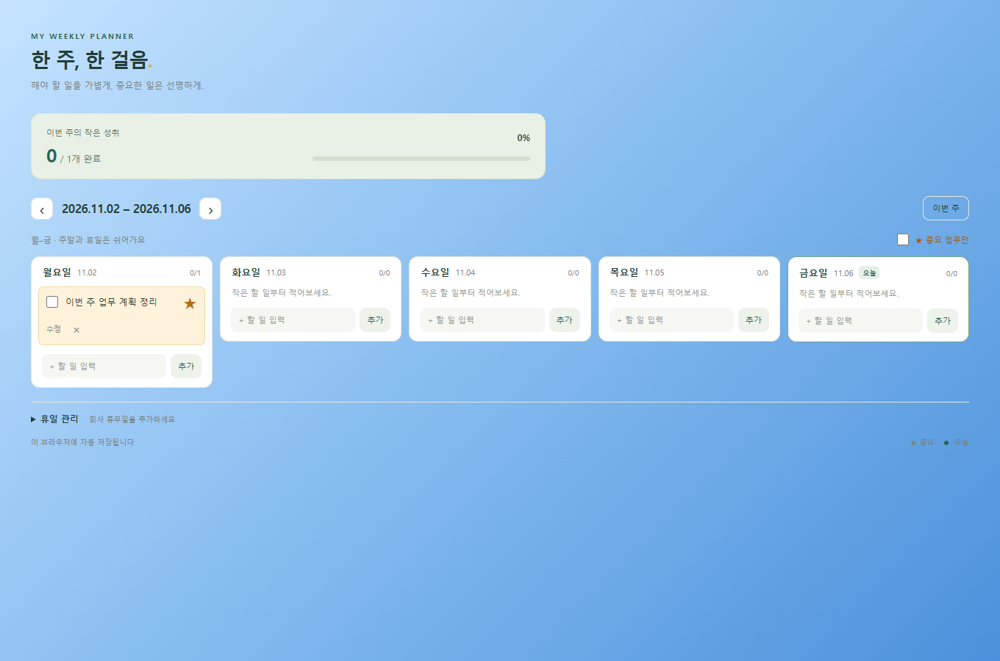

# 한 주, 한 걸음 · 주간 업무 체크

## 한 줄 소개

주말과 휴일을 제외한 주간 업무를 날짜별로 적고, 중요한 일과 완료한 일을 한눈에 확인하는 크롬 확장프로그램입니다.

## 누구를 위해 만들었나요

아침에 할 일을 정리하고, 한 주 동안 중요한 업무를 놓치지 않고 체크하고 싶은 사람을 위해 만들었습니다. 닉네임: linainvers-1106.

## 주요 기능

- 월요일부터 금요일까지 날짜별 업무 추가·수정·삭제와 주간 이동
- 완료 체크와 진행률 표시, 별표로 지정하는 주황색 중요 업무 및 중요 업무 필터
- 주말·2026~2027년 공휴일 제외, 회사 휴무일 직접 등록 및 브라우저 자동 저장

## 화면

## 강사 예시에서 바꾼 점

- 단순한 일일 할 일 목록에서 확장해, 요청한 아이디어에 맞는 주간 업무 관리 프로그램을 새로 만들었습니다.
- 주말과 휴일은 숨기고, 해당 날짜에 작성했던 업무는 보관하도록 했습니다.
- 중요한 업무를 별표와 주황색으로 표시하고, 배경에 파란색 그라데이션을 적용했습니다.
- 넓게 보기, 오늘 강조, 주간 완료율, 저장 실패 안내를 추가했습니다.

## 써 보는 법

1. 크롬에서 chrome://extensions를 열고 개발자 모드를 켠 뒤, 압축해제된 확장 프로그램 로드로 이 폴더를 선택합니다.
2. 날짜별 입력란에 업무를 추가하고 체크박스로 완료하거나 별표로 중요 업무를 표시합니다.
3. 휴일 관리에서 휴무일을 추가하거나 넓게 보기로 한 주를 한눈에 확인합니다. 자세한 설치 설명은 INSTALL.md를 참고하세요.

## 다음에 붙이고 싶은 기능

- 향후 개선 후보: 업무 알림과 미완료 업무 다음 주로 옮기기

## 만들면서 배운 점

주간 업무에는 날짜별 저장과 휴일 처리가 필요합니다. 공휴일 자료의 적용 연도를 안내하고, 저장 오류가 나도 입력 내용이 유지되도록 구현했습니다.
