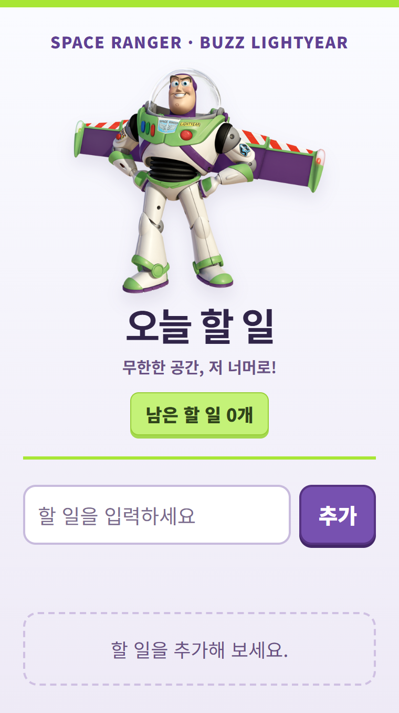
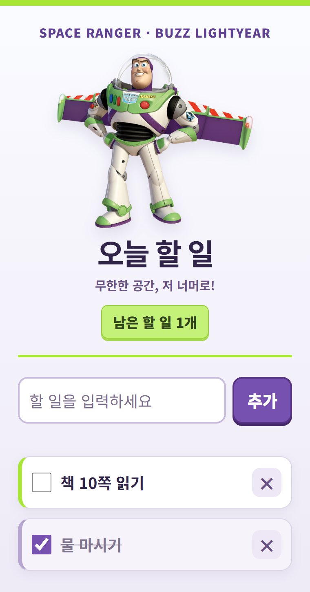

# 오늘 할 일 작성기 · 버즈 라이트이어 테마

## 한 줄 소개

버즈 라이트이어 테마 화면에서 오늘 할 일을 추가하고 완료·삭제할 수 있는 크롬 확장 프로그램입니다.

## 누구를 위해 만들었나요

할 일을 간단히 기록하고, 남은 할 일을 한눈에 확인하면서 하루를 정리하고 싶은 사람을 위해 만들었습니다.

## 주요 기능

- 할 일을 입력해 추가하고, 체크박스로 완료 상태를 변경합니다.
- 남은 할 일 개수를 표시하고 필요 없는 항목은 삭제합니다.
- 목록을 브라우저 로컬 저장소에 저장해 팝업을 다시 열어도 유지합니다.

## 화면

캡처는 코드로 렌더링한 팝업 화면이며, 격리된 샘플 저장소를 사용했습니다. “물 마시기”, “책 10쪽 읽기” 같은 가상의 할 일만 표시했습니다.

## 강사 예시에서 바꾼 점

- 기본 할 일 작성기 화면에 버즈 라이트이어 캐릭터 이미지와 “무한한 공간, 저 너머로!” 문구를 추가했습니다.
- 보라색·연두색 테마, 큰 글씨와 체크박스, 카드 형태의 목록으로 화면을 꾸몄습니다.
- 할 일 추가·완료·삭제·로컬 저장 기능은 기본 예시의 동작을 유지했습니다.

## 써 보는 법

1. 이 폴더를 내려받고 Chrome 주소창에 `chrome://extensions`를 입력합니다. 개발자 모드를 켠 뒤 **압축해제된 확장 프로그램 로드**에서 이 폴더를 선택합니다.
2. 확장 프로그램 아이콘을 누르고 할 일을 입력한 뒤 **추가**를 누릅니다.
3. 완료한 항목은 체크하고, 지울 항목은 **×**를 누릅니다.

## 다음에 붙이고 싶은 기능

- 할 일 마감일과 우선순위 표시.
- 완료한 할 일을 한 번에 정리하는 기능.

## 만들면서 배운 점

HTML과 CSS의 이미지·색상·글씨 크기를 바꾸면 같은 기능도 다른 분위기로 표현할 수 있었습니다. 코드 검토와 Chrome 화면 점검에서 빈 입력 안내, 할 일 추가·완료·삭제, 남은 개수, 저장 후 재열기를 확인했습니다. 화면 점검에는 Chrome 저장소 API 모형을 사용했습니다.
