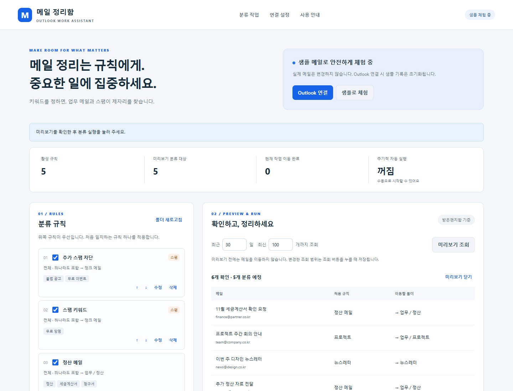

# 오늘 할 일 작성기 + Outlook 메일 정리함

## 한 줄 소개

버즈 라이트이어 테마의 할 일 작성기와, 키워드로 업무 메일·스팸을 정리하는 Outlook 확장 프로그램을 함께 만들었습니다.

## 누구를 위해 만들었나요

할 일을 간단히 기록하며 하루를 정리하고 싶은 사람, Outlook 받은편지함을 반복해서 분류하는 업무를 줄이고 싶은 사람을 위해 만들었습니다.

## 주요 기능

- 할 일을 입력해 추가하고, 체크박스로 완료 상태를 변경합니다.
- 남은 할 일 개수를 표시하고 필요 없는 항목은 삭제합니다.
- 목록을 브라우저 로컬 저장소에 저장해 팝업을 다시 열어도 유지합니다.
- 별도의 메일 정리함에서는 제목·보낸 사람·본문의 키워드로 메일을 폴더별로 분류하고, 스팸을 정크 메일함으로 자동 이동합니다.
- 메일 이동 미리보기·실행·중단·이어하기·되돌리기와 주기적 자동 실행을 지원합니다.

## 화면

캡처는 코드를 Chrome에서 렌더링한 화면이며, 격리된 샘플 저장소를 사용했습니다. 할 일과 메일은 가상 데이터입니다. 실제 계정·회사 메일은 포함하지 않았습니다.

## 강사 예시에서 바꾼 점

- 기본 할 일 작성기 화면에 버즈 라이트이어 캐릭터 이미지와 “무한한 공간, 저 너머로!” 문구를 추가했습니다.
- 보라색·연두색 테마, 큰 글씨와 체크박스, 카드 형태의 목록으로 화면을 꾸몄습니다.
- 할 일 추가·완료·삭제·로컬 저장 기능은 기본 예시의 동작을 유지했습니다.
- 메일 분류 업무용 확장 프로그램을 별도로 추가했습니다. 자세한 기능과 안내는 [Outlook 메일 정리함 소개](mail-assistant/README.md)에서 확인할 수 있습니다.

## 써 보는 법

1. **할 일 작성기:** Chrome의 `chrome://extensions`에서 개발자 모드를 켜고 **압축해제된 확장 프로그램 로드**로 이 `lth1213` 폴더를 선택합니다. 아이콘을 눌러 할 일을 추가·체크·삭제합니다.
2. **메일 정리함:** 같은 메뉴에서 이 폴더 안의 **`mail-assistant` 폴더**를 따로 선택해 설치합니다. 메일 정리함 아이콘을 눌러 **샘플로 체험 → 미리보기 조회 → 분류 실행**을 사용합니다.
3. 실제 메일을 사용하려면 [Microsoft 앱 등록·계정 연결 안내](mail-assistant/INSTALL.md)를 따릅니다. 실제 계정의 로그인과 메일 이동은 앱 등록 후 확인이 필요합니다.

두 개의 독립된 확장 프로그램이므로 각각 설치합니다. 스팸 규칙을 저장하면 기본 15분마다 모든 활성 분류 규칙이 자동 적용됩니다. Chrome이 실행 중일 때 동작하며, 정크 메일함 이동은 Microsoft 스팸 필터 학습·신고와 별개입니다.

## 다음에 붙이고 싶은 기능

- 할 일 마감일과 우선순위 표시.
- 완료한 할 일을 한 번에 정리하는 기능.
- 메일 분류 규칙 내보내기·가져오기와 오분류 통계.

## 만들면서 배운 점

HTML과 CSS의 이미지·색상·글씨 크기를 바꾸면 같은 기능도 다른 분위기로 표현할 수 있었습니다. 코드 검토와 Chrome 화면 점검에서 빈 입력 안내, 할 일 추가·완료·삭제, 남은 개수, 저장 후 재열기를 확인했습니다. 화면 점검에는 Chrome 저장소 API 모형을 사용했습니다.

메일 분류에서는 요청이 끊겼을 때 실제 폴더를 확인한 뒤 이어가는 처리가 필요했습니다. 키워드 판정·이동·스팸·복구·중단 등 9개 자동 테스트와 Chrome API 모형을 사용한 화면 테스트를 통과했습니다. 실제 Microsoft 로그인 및 사서함 이동은 사용자 계정 연결 후 별도 검증이 필요합니다.
