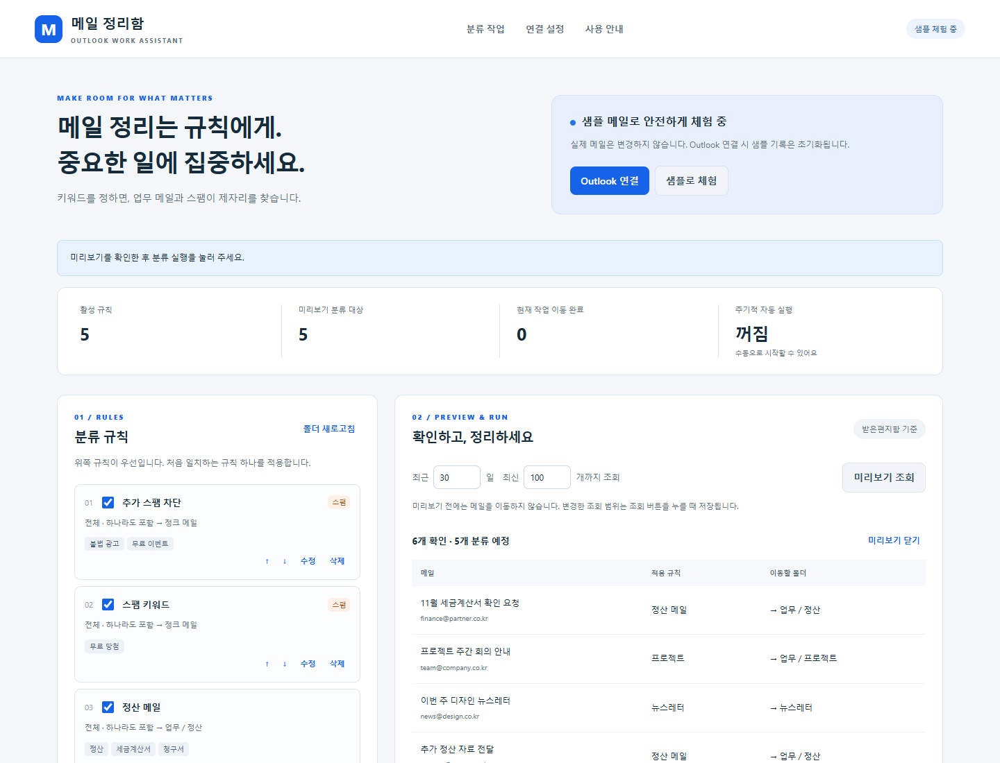

# 메일 정리함 · Outlook 업무 도우미

## 한 줄 소개

Outlook 메일을 키워드로 분류하고 스팸을 정크 메일함으로 자동 이동하는 업무 보조 확장 프로그램입니다.

## 누구를 위해 만들었나요

받은편지함에서 업무 메일을 반복적으로 분류하고, 광고·스팸 메일을 키워드로 정리하고 싶은 사람을 위해 만들었습니다.

## 주요 기능

- 제목·보낸 사람·본문의 키워드로 분류 규칙과 우선순위를 설정하고, 실행 전 이동할 폴더를 미리 확인합니다.
- 분류 실행·중단·이어하기·되돌리기와 최근 작업 기록을 지원합니다.
- 스팸 규칙을 저장하면 자동 실행을 켜고, 기본 15분마다 정크 메일함으로 이동합니다. 자동 실행에는 모든 활성 규칙이 적용됩니다.

## 화면

대표 화면은 가상의 샘플 메일을 사용했습니다. 실제 계정이나 업무 메일은 포함하지 않았습니다.

## 강사 예시에서 바꾼 점

- 할 일 작성기 중심 예시에서 발전시켜, 메일 분류 업무를 위한 별도의 Outlook 확장 프로그램으로 만들었습니다.
- Microsoft Graph 기반 폴더 이동, 키워드 규칙, 미리보기, 중단·복구 및 자동 실행 기능을 구현했습니다.
- 실제 계정 연결 전에 사용할 수 있는 샘플 메일 체험 모드를 추가했습니다.

## 써 보는 법

1. 이 폴더를 내려받은 뒤 Chrome의 `chrome://extensions`에서 개발자 모드를 켜고 **압축해제된 확장 프로그램 로드**로 이 폴더를 선택합니다.
2. 확장 프로그램 아이콘을 눌러 **샘플로 체험 → 미리보기 조회 → 분류 실행**을 시도합니다. **현재 작업 되돌리기**로 복구할 수 있습니다.
3. 실제 Outlook 계정 사용 시 [설치·계정 연결 안내](INSTALL.md)에 따라 Microsoft 앱을 등록하고 로그인한 뒤 규칙을 새로 만듭니다. 스팸 규칙 저장 시 자동 실행이 켜집니다.

Microsoft 365 / Outlook.com 본인 사서함을 대상으로 합니다. 실제 로그인과 사서함 이동은 사용자 앱 등록 후 검증해야 합니다. 정크 메일함 이동은 Microsoft 스팸 신고·필터 학습과 별개입니다.

## 다음에 붙이고 싶은 기능

- 분류 규칙 내보내기·가져오기와 처리 기록 검색.
- 규칙별 오분류 통계와 더 세밀한 자동 실행 시간 설정.

## 만들면서 배운 점

메일 이동 중 응답이 끊어지면 실제 이동 여부와 화면 기록이 달라질 수 있어, 이어하기 전에 메일의 현재 폴더를 확인하도록 구현했습니다. 분류·스팸 이동·복구·중단 등 9개 자동 테스트와 Chrome API 모형을 사용한 화면 테스트를 통과했으며, 실제 계정 연결은 별도 확인이 필요합니다.
