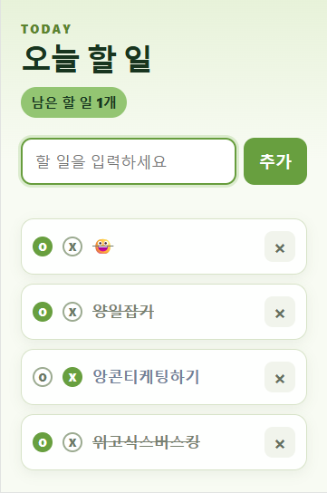

# 오늘 할 일 작성기

## 한 줄 소개

오늘 할 일을 적고, 완료 여부를 표시하며 하루의 할 일을 관리하는 크롬 확장 프로그램입니다.

## 누구를 위해 만들었나요

오늘 해야 할 일을 간단히 적어 두고, 완료한 일과 하지 못한 일을 구분하고 싶은 사람을 위해 만들었습니다.

## 주요 기능

- 할 일을 추가하고 삭제할 수 있습니다.
- 완료는 O, 하지 못함은 X로 표시하고 상태를 저장합니다.
- 완료를 누르면 여러 폭죽이 터지고, 하지 못함을 누르면 빗방울이 내립니다.
- 긴 할 일은 항목 너비에 맞춰 자연스럽게 줄바꿈됩니다.

## 화면

## 강사 예시에서 바꾼 점

- 긴 할 일이 한 줄로 잘리지 않도록 줄바꿈을 적용했습니다.
- 완료와 하지 못함 상태를 O와 X 모양의 체크박스로 구분했습니다.
- 완료할 때는 폭죽이 여러 위치에서 터지고, 하지 못함을 표시할 때는 빗방울이 내리도록 효과를 추가했습니다.

## 써 보는 법

1. 크롬에서 확장 프로그램을 열고 할 일을 입력한 뒤 추가를 누릅니다.
2. 완료했으면 O, 하지 못했으면 X를 눌러 상태를 표시합니다.

## 다음에 붙이고 싶은 기능

- 날짜별로 할 일과 완료 기록을 모아 볼 수 있는 기능을 추가하고 싶습니다.

## 만들면서 배운 점

체크박스 상태를 저장하는 방법과 CSS 애니메이션으로 상태에 따라 다른 화면 효과를 보여 주는 방법을 익혔습니다.