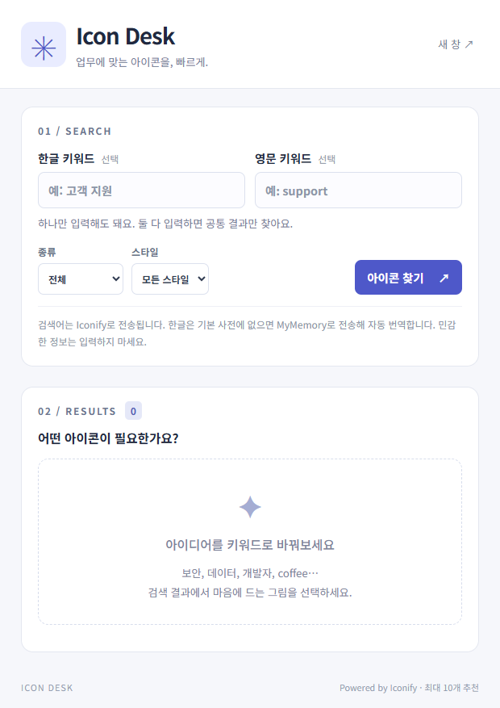
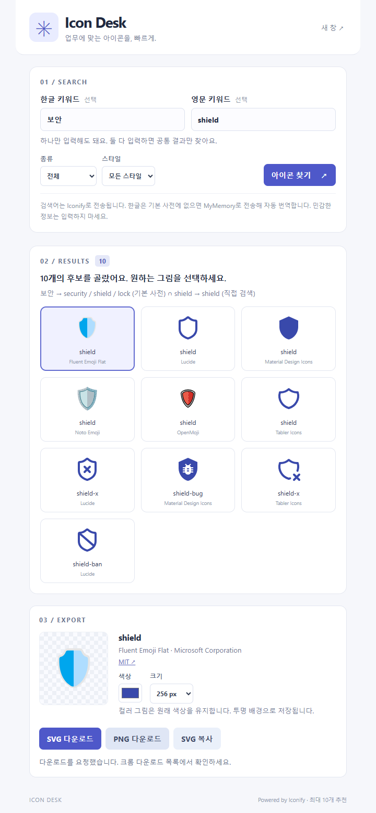

# Icon Desk · 아이콘 데스크

**제작 닉네임: ppunchi · 1라운드 제출 · 버전 1.0.0**

## 한 줄 소개

한글·영문 키워드로 아이콘과 인물 그림을 찾아, 색상과 크기를 조절하고 투명 배경의 SVG·PNG로 내려받는 크롬 확장 프로그램입니다.

## 누구를 위해 만들었나요

발표 자료, 기획서, 웹 화면을 만들 때 필요한 아이콘을 빠르게 찾고 싶은 사람을 위해 만들었습니다. 여러 사이트를 오가며 검색하고 파일 형식을 바꾸는 과정을 작은 확장 프로그램 안에서 처리할 수 있습니다.

- 영어 이름이 바로 떠오르지 않아 한글로 아이콘을 찾고 싶은 사람
- 문서나 화면의 분위기에 맞춰 아이콘 색상과 크기를 바꾸고 싶은 사람
- 아이콘과 아바타·인물 그림을 함께 찾아보고 싶은 사람

## 주요 기능

- **한글·영문 검색:** 한쪽만 입력해도 검색하며, 두 칸을 모두 입력하면 공통 결과(AND)만 보여 줍니다. 자주 쓰는 한글 업무 단어는 내장 사전으로 변환하고, 나머지는 외부 번역 API로 영어로 바꿉니다.
- **필터와 후보 비교:** 전체 / 아이콘 / 아바타·인물, 전체 / 선형 / 채움 / 컬러 필터를 제공합니다. 여러 컬렉션의 검색 결과를 분산해 최대 10개까지 보여 줍니다.
- **편집과 내보내기:** 단색 아이콘의 색상을 바꾸고 128 / 256 / 512 / 1024px 크기를 선택할 수 있습니다. SVG 다운로드, PNG 다운로드, SVG 코드 복사를 지원하며 출처와 라이선스 링크를 함께 표시합니다.
- **별도 창으로 열기:** 팝업이 닫히는 불편을 줄이도록 새 창에서 작업할 수 있습니다. 현재 검색 조건을 전달해 새 창에서 다시 검색합니다.

## 화면

### 처음 실행한 화면

한글·영문 입력 칸, 종류·스타일 필터, 검색 안내를 볼 수 있는 실제 초기 화면입니다.



### 검색하고 다운로드하는 화면

실제 확장 프로그램을 Edge에 로드하여 `보안`과 `shield`를 함께 검색한 화면입니다. 공통 후보 10개와 선택한 아이콘의 미리보기, 색상·크기 설정, SVG·PNG 다운로드 버튼을 보여 줍니다.



## 강사 예시에서 바꾼 점

- 할 일 작성기 예시와 다른 주제로, **아이콘 검색과 다운로드를 위한 도구**를 만들었습니다.
- 화면을 검색 → 결과 비교 → 선택한 그림 내보내기의 세 단계로 구성했습니다.
- 한글만 입력하는 경우와 영문만 입력하는 경우, 두 언어를 함께 입력하는 경우의 검색 규칙을 구분했습니다.
- 아이콘 유형과 스타일 필터, 색상 변경, 네 가지 출력 크기, SVG·PNG 저장 기능을 넣었습니다.
- 외부 API 오류, 번역 실패, 결과 없음, 입력 누락을 화면에서 안내하도록 했습니다.

## 써 보는 법

### 설치하기

1. 이 저장소를 내려받아 압축을 풀거나 Git으로 복제합니다.
2. 크롬 주소창에 `chrome://extensions`를 입력합니다.
3. 오른쪽 위 **개발자 모드**를 켜고 **압축해제된 확장 프로그램을 로드합니다**를 누릅니다.
4. `round1/ppunchi` 폴더를 선택합니다. 선택한 폴더 바로 안에 `manifest.json`이 있어야 합니다.
5. 확장 프로그램 메뉴에서 **Icon Desk · 아이콘 데스크**를 엽니다. 자주 쓴다면 도구 모음에 고정합니다.

별도 회원가입, API 키, 서버 실행, 빌드 과정 없이 사용할 수 있습니다. 검색과 이미지 불러오기에는 인터넷 연결이 필요합니다.

### 검색하고 저장하기

1. 한글 또는 영문 키워드를 입력합니다. 처음에는 `보안` 하나로 검색해 보세요.
2. 필요한 경우 종류와 스타일을 고르고 **아이콘 찾기**를 누릅니다.
3. 결과 카드에서 그림을 선택하고 출처와 **라이선스 확인** 링크를 확인합니다.
4. 단색 아이콘이라면 색상을 바꾸고, 원하는 크기를 선택합니다.
5. **SVG 다운로드**, **PNG 다운로드**, **SVG 복사** 중 하나를 누릅니다. 파일 저장 위치는 브라우저의 다운로드 설정을 따릅니다.

| 입력 예시 | 동작 |
| --- | --- |
| 한글 `보안`, 영문 비움 | 한글을 변환한 키워드로 검색 |
| 한글 비움, 영문 `coffee` | 영문 키워드로 검색 |
| 한글 `보안`, 영문 `shield` | 두 검색 결과에 공통으로 포함되는 그림만 표시 |
| 한글 `보안`, 영문 `coffee` | 공통 후보가 없다면 결과 없음 안내 |
| 한글 `의사`, 종류 `아바타 · 인물` | 인물 관련 아이콘과 이모지 후보 검색 |

두 칸을 함께 입력했을 때 결과가 적다면 하나를 비우거나 필터를 전체로 바꿔 보세요. 컬러 그림은 원래 색상을 유지하므로 색상 변경이 비활성화됩니다. 아바타 검색은 기존 그림을 찾는 기능이며 새로운 얼굴을 생성하지 않습니다.

### 데이터와 이용 조건

- **Iconify:** 변환된 검색어와 영문 검색어로 아이콘을 검색하고 이미지를 불러옵니다. Lucide, Tabler, Material Design Icons, Noto, OpenMoji, Fluent Emoji Flat 컬렉션을 사용합니다.
- **MyMemory:** 내장 사전에 없는 한글 입력을 영어로 번역할 때 사용합니다. 영문만 입력하거나 내장 사전으로 처리되는 한글은 번역 서비스로 보내지 않습니다.
- 검색 요청 시 외부 서비스에 검색어와 IP 주소 등 일반 네트워크 정보가 전달됩니다. 개인정보나 회사 내부 정보를 검색어로 입력하지 마세요.
- 현재 페이지의 내용, 방문 기록, 계정 정보를 읽지 않습니다. 두 API 도메인에 대한 호스트 권한을 사용합니다.
- 검색 기록과 선택을 영구 저장하지 않습니다. 열린 창 안에서는 검색 결과를 일시 캐시합니다.
- 컬렉션마다 이용 조건이 다릅니다. 다운로드 전에 표시되는 라이선스를 확인하세요. SVG에는 출처·제작자·라이선스 메타데이터를 넣지만, 이것이 라이선스에서 요구하는 출처 표시를 대신하지는 않습니다.

### 문제가 생겼을 때

| 상황 | 확인할 내용 |
| --- | --- |
| 검색이 실패하거나 오래 걸림 | 인터넷 연결을 확인하고 잠시 후 다시 검색합니다. |
| 한글 번역 실패 | 한글을 짧게 바꾸거나 영문 칸만 사용합니다. |
| 결과가 없음 | 키워드 하나만 입력하거나 종류·스타일을 전체로 바꿉니다. |
| SVG 복사가 안 됨 | SVG 다운로드 버튼을 사용합니다. |
| 파일 수정 후 이전 화면이 보임 | 확장 프로그램 관리 화면에서 새로고침한 뒤 다시 엽니다. |

### 파일 구성과 검증

| 파일 | 역할 |
| --- | --- |
| `manifest.json` | Manifest V3 설정, 팝업, 아이콘, API 호스트 권한 |
| `popup.html` | 검색·결과·내보내기 화면 구조 |
| `popup.css` | 화면 스타일과 반응형 배치 |
| `popup.js` | 화면 동작, 선택, 색상 변경, 파일 저장 |
| `search-core.js` | 한글 변환, API 요청, 교집합 검색, 후보 분산 |
| `icons/` | 확장 프로그램 도구 모음 아이콘 |
| `tests/search.test.cjs` | 검색 핵심 로직 자동 테스트 |
| `screenshot.png`, `screenshot-2.png` | 초기 화면과 실제 검색 화면 |

제출 준비 과정에서 핵심 로직 테스트 5개를 통과했습니다. 별도 임시 Edge 프로필에 실제 확장 프로그램을 로드하여 한글·영문 교집합 검색, 이미지 10개 로딩, SVG·PNG 다운로드, 한글 자동 번역 동작도 확인했습니다. 기능 화면 캡처는 이 실제 실행에서 얻었습니다.

Node.js가 설치되어 있다면 이 `ppunchi` 폴더에서 핵심 로직 테스트를 다시 실행할 수 있습니다.

```sh
node --test tests/search.test.cjs
```

일반 사용에는 Node.js가 필요하지 않습니다.

## 다음에 붙이고 싶은 기능

- 자주 사용하는 아이콘을 다시 찾기 위한 즐겨찾기
- 한국어 검색 사전 확장과 자주 쓰는 검색어 추천
- 선택한 아이콘 여러 개를 한 번에 내려받는 기능
- 최근 사용한 색상과 출력 크기를 기억하는 설정

위 항목은 향후 개선 아이디어이며 현재 버전에는 포함하지 않았습니다.

## 만들면서 배운 점

한글과 영문을 동시에 입력하는 기능에서는 두 입력의 의미를 명확히 정하는 것이 중요했습니다. 공통 결과만 보여 주는 규칙을 화면에 안내하고, 실제 검색에 사용한 변환 키워드를 표시해 결과를 이해하기 쉽게 만들었습니다.

또한 화면에 그림이 보이는 것과 올바른 파일로 저장되는 것은 별도로 확인해야 했습니다. 검색 로직 테스트에 더해 실제 확장 프로그램 환경에서 이미지 로딩과 SVG·PNG 다운로드를 검증하는 과정을 거쳤습니다. 외부 데이터를 사용할 때는 오류 처리뿐 아니라 출처와 라이선스를 함께 보여 주는 것도 필요하다는 점을 배웠습니다.
