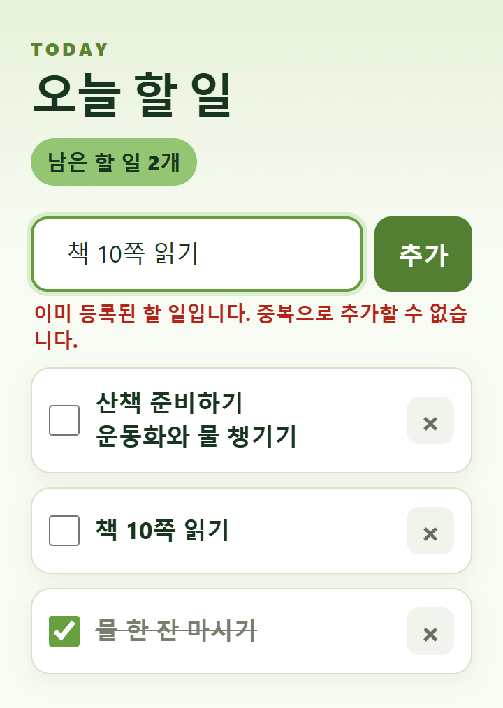

# 오늘 할 일 작성기

**제작 닉네임: ppunchi · 1라운드 제출 · 버전 1.0.0**

## 한 줄 소개

오늘 해야 할 일을 적고, 완료 여부와 남은 개수를 확인하며, 브라우저를 다시 열어도 목록을 이어서 관리하는 크롬 확장 프로그램입니다.

## 누구를 위해 만들었나요

복잡한 일정 관리 도구 대신, 브라우저에서 오늘 할 일을 간단히 확인하고 싶은 사람을 위해 만들었습니다. 짧은 메모뿐 아니라 여러 줄로 적은 할 일도 읽기 편하게 보여 주며, 같은 내용을 실수로 여러 번 추가하지 않도록 했습니다.

## 주요 기능

- **할 일 추가와 중복 방지:** 최대 100자까지 입력할 수 있으며, 새 항목은 목록 맨 위에 나타납니다. 빈 내용이나 이미 등록된 동일한 내용은 안내 문구와 함께 추가를 막습니다. 앞뒤 공백을 제거한 뒤 비교하며, 완료한 항목도 중복 검사에 포함됩니다.
- **완료 체크·삭제·남은 개수 표시:** 체크박스로 완료 상태를 바꾸면 글자에 취소선이 표시되고, 미완료 항목의 개수가 즉시 갱신됩니다. 각 항목의 `×` 버튼으로 삭제할 수 있습니다.
- **여러 줄 입력과 로컬 저장:** 입력 내용에 맞춰 입력창 높이가 늘어나고, 목록에서도 줄바꿈을 유지합니다. 할 일과 완료 상태는 `chrome.storage.local`에 저장되어 팝업을 닫았다 열어도 유지됩니다.

## 화면

### 처음 열었을 때

아직 등록한 항목이 없는 초기 화면입니다. 남은 할 일 개수, 입력창, 추가 버튼을 볼 수 있습니다.

### 할 일을 추가하고 완료한 모습

개인정보가 없는 예시 할 일로 촬영했습니다. 여러 줄 항목의 표시, 완료 항목의 취소선, 남은 개수를 확인할 수 있습니다.

### 중복 입력을 안내하는 모습

이미 등록한 할 일을 다시 추가하면 목록을 늘리지 않고 오류 메시지를 표시합니다.

## 강사 예시에서 바꾼 점

- 강사 기본 예시의 할 일 추가, 완료 체크, 삭제, 로컬 저장 기능을 유지하면서 중복 입력 방지 기능을 추가했습니다.
- 한 줄 입력창을 여러 줄 입력이 가능한 `textarea`로 바꾸고, 입력 길이에 따라 높이가 자동으로 늘어나도록 했습니다.
- 목록에서도 줄바꿈을 유지하고 긴 내용이 카드 안에서 줄바꿈되도록 했습니다.
- Enter는 줄바꿈에 사용하고, 할 일 등록은 **추가** 버튼을 눌러 실행하도록 바꿨습니다.
- 연두색 배경과 녹색 버튼, 카드 형태 목록으로 화면을 꾸미고, 제목과 본문 글자 크기를 키웠습니다.

## 써 보는 법

### 설치

1. 저장소를 내려받아 압축을 풀거나 Git으로 복제합니다.
2. 크롬 주소창에 `chrome://extensions`를 입력합니다.
3. **개발자 모드**를 켜고 **압축해제된 확장 프로그램을 로드합니다**를 누릅니다.
4. 제출본의 `round1/ppunchi` 폴더를 선택합니다. 이 폴더 바로 안에 `manifest.json`이 있어야 합니다. 원본으로 설치할 때는 `todo-extension` 폴더를 선택하면 됩니다.
5. 확장 프로그램 메뉴에서 **오늘 할 일 작성기**를 엽니다. 자주 사용한다면 도구 모음에 고정합니다.

별도 회원가입, API 키, 빌드 과정은 필요하지 않습니다.

### 사용

1. 입력창에 할 일을 적습니다. Enter를 누르면 줄을 바꿀 수 있습니다.
2. **추가** 버튼을 눌러 목록에 등록합니다.
3. 끝낸 일은 체크박스를 선택합니다. 다시 선택하면 미완료 상태로 돌아갑니다.
4. 필요 없는 항목은 오른쪽 **×** 버튼으로 삭제합니다. 삭제 취소 기능은 없습니다.
5. 팝업을 다시 열면 저장된 목록과 완료 상태가 복원됩니다.

### 사용 시 알아둘 점

- 이름에 ‘오늘’이 들어가지만 날짜별 분류나 자정 자동 초기화 기능은 없습니다. 항목은 직접 삭제할 때까지 유지됩니다.
- 완료 항목은 원래 위치에 남고, 새로 등록한 항목이 맨 위에 추가됩니다.
- 동일한 내용의 항목을 다시 등록하려면 기존 항목을 먼저 삭제해야 합니다.
- 저장 범위는 현재 브라우저 프로필의 확장 프로그램 로컬 저장소입니다. 계정 간 동기화나 파일 백업 기능은 없습니다.
- 외부 서버나 API로 할 일 내용을 전송하는 코드는 없으며, 요청하는 권한은 `storage` 하나입니다.
- 확장 프로그램을 삭제하면 로컬 데이터가 사라질 수 있으므로 중요한 내용을 보관하는 유일한 수단으로 사용하지 마세요.

### 파일 구성

| 파일 | 역할 |
| --- | --- |
| `manifest.json` | Manifest V3, 팝업, 저장소 권한 설정 |
| `popup.html` | 입력창·할 일 목록·남은 개수 화면 구성 |
| `popup.css` | 연두색 테마, 카드 목록, 여러 줄 입력 스타일 |
| `popup.js` | 추가, 중복 검사, 완료 처리, 삭제, 로컬 저장 |
| `README.md` | 소개와 설치·사용 안내 |
| `screenshot.png` | 초기 화면 캡처 |
| `screenshot-2.png` | 여러 줄 할 일과 완료 상태 캡처 |
| `screenshot-3.png` | 중복 입력 안내 캡처 |

코드를 수정했다면 확장 프로그램 관리 화면에서 **새로고침**을 누른 뒤 팝업을 다시 엽니다. 목록을 불러오지 못했다는 안내가 나타나면 일반 HTML 파일로 연 것은 아닌지 확인하고, 확장 프로그램으로 설치해 실행합니다.

## 다음에 붙이고 싶은 기능

- 날짜별 할 일 분류와 이전 날짜 목록 보기
- 완료한 항목을 한 번에 정리하는 기능
- 할 일 내용 수정과 순서 변경
- 목록 백업·복원과 삭제 취소

위 기능은 향후 개선 아이디어이며 현재 버전에는 포함하지 않았습니다.

## 만들면서 배운 점

입력창을 여러 줄로 바꾸면 Enter의 의미도 함께 정해야 한다는 점을 배웠습니다. Enter는 줄바꿈, **추가** 버튼은 등록으로 역할을 나누고 입력창 높이와 목록의 줄바꿈 표현을 함께 조정했습니다.

또한 중복 입력 검사는 화면에 같은 글자가 보이는지만 비교하기보다 앞뒤 공백을 정리한 뒤 검사해야 실수를 줄일 수 있었습니다. 할 일 추가뿐 아니라 완료 상태와 삭제 결과도 로컬 저장소에 반영해야 팝업을 다시 열었을 때 같은 상태를 이어갈 수 있습니다.
