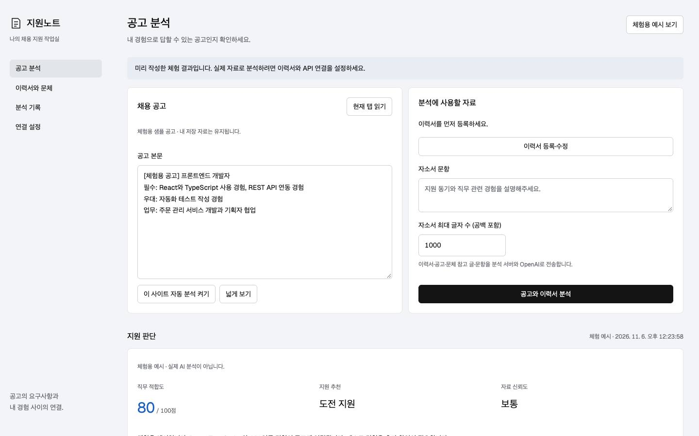
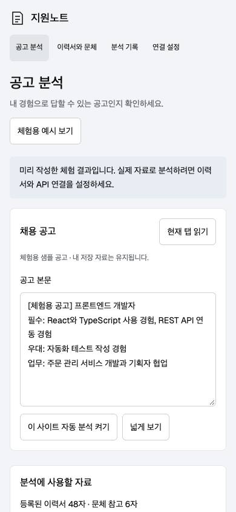

# 지원노트 · 채용 지원 도우미

## 한 줄 소개
채용 공고와 이력서를 비교하고 근거를 확인하면서 맞춤 이력서와 자기소개서를 작성하는 Chrome 확장 프로그램입니다.

## 누구를 위해 만들었나요
여러 채용 공고에 지원하면서 요구사항과 내 경험을 비교하고, 지원 문서를 효율적으로 다듬고 싶은 구직자를 위해 만들었습니다.

## 주요 기능
- 현재 탭의 채용 공고 읽기 또는 본문 직접 붙여넣기
- PDF·DOCX·TXT·MD 이력서 텍스트 추출과 로컬 저장
- 공고 요구사항과 이력서 근거 비교, 직무 적합도와 지원 추천 확인
- 맞춤 이력서·자기소개서 초안 편집, 저장, 복사 및 TXT 다운로드
- 허용한 사이트의 자동 분석과 최근 분석 기록 확인
- API 키 없이 사용할 수 있는 체험용 예시

## 화면
대표 화면은 미리 작성된 체험용 예시입니다. 실제 AI 분석 결과가 아닙니다.

## 강사 예시에서 바꾼 점
- 할 일 관리 대신 채용 공고와 이력서를 비교하는 지원 준비 도구를 만들었습니다.
- 사이드 패널, 파일 텍스트 추출, 근거 비교와 문서 초안 편집 기능을 구성했습니다.
- API 키를 확장 프로그램에 넣지 않고 개인 컴퓨터의 로컬 서버에서 관리하도록 구성했습니다.

## 써 보는 법
1. 이 폴더를 내려받아 Chrome의 `chrome://extensions`에서 개발자 모드를 켭니다.
2. 압축해제된 확장 프로그램 로드에서 이 폴더를 선택합니다. `manifest.json`이 폴더 바로 안에 있어야 합니다.
3. 확장 아이콘을 누르고 **체험용 예시 보기**로 기능과 화면을 확인합니다.
4. 실제 분석은 Node.js 22 이상에서 이 폴더로 이동해 `npm install`을 실행하고, `.env.example`을 `.env`로 복사한 뒤 본인의 API 키와 모델을 설정합니다.
5. `npm start`로 서버를 실행하고 표시되는 연결 토큰을 확장 프로그램의 연결 설정에 입력합니다. 전송 동의와 이력서 등록 후 분석합니다.
6. 자세한 설정과 제한은 [사용안내](사용안내.md)를 확인합니다. 실제 분석 시 자료가 OpenAI로 전송되고 API 비용이 발생합니다.

## 다음에 붙이고 싶은 기능
- 채용 사이트별 공고 추출 정확도 개선
- Word 서식을 유지하는 문서 내보내기

## 만들면서 배운 점
화면 구성과 AI 연결을 나누고, 실제 분석과 체험 예시를 구분하는 것이 필요했습니다. 원문 근거를 확인하고 입력을 검증하는 과정도 중요했습니다.

제출: 유성현 · round1

검증: 원본 프로젝트의 입력 검증·점수 계산·AI 응답 검증·서버 인증 테스트 4개 통과. 실제 API 호출은 이번 제출 확인에서 실행하지 않았습니다.
