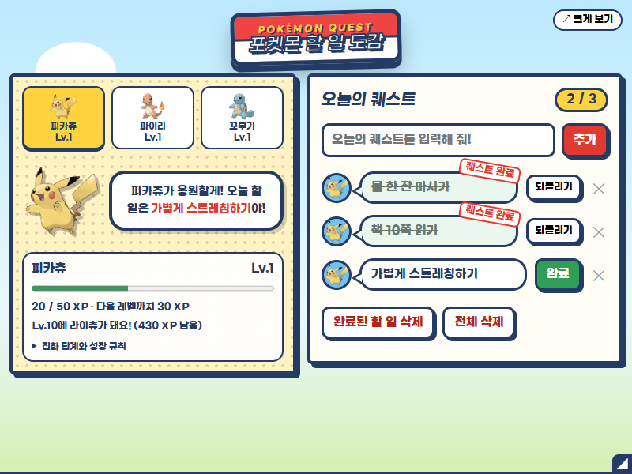
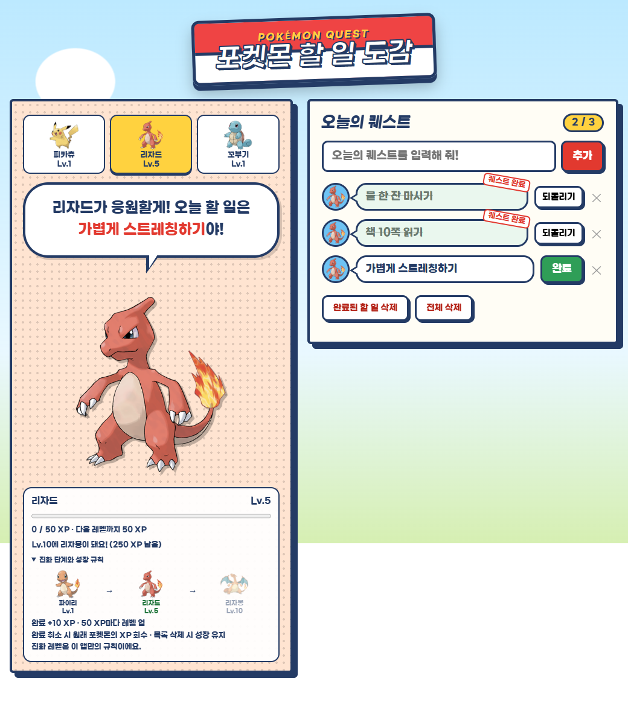

# 포켓몬 할 일 도감

## 한 줄 소개

할 일을 완료하며 피카츄·파이리·꼬부기를 키우고 진화시키는 게임형 투두리스트입니다. 닉네임: 리코딩.

## 누구를 위해 만들었나요

작은 할 일을 즐겁게 실천하고, 완료할 때마다 성장 보상을 받고 싶은 사람을 위해 만들었습니다.

## 주요 기능

- 할 일 추가·완료·되돌리기, 개별 삭제·완료된 할 일 삭제·전체 삭제와 자동 저장
- 피카츄·파이리·꼬부기 선택, 포켓몬별 경험치·레벨 저장과 자동 진화
- 긴 문장 자동 줄바꿈, 캐릭터 응원 애니메이션, 팝업 가로·세로 드래그 조절과 크기 저장

## 화면

## 강사 예시에서 바꾼 점

- 우디 테마를 포켓몬 테마와 공식 캐릭터 이미지로 바꿨습니다.
- 완료 1개당 10 XP, 50 XP마다 레벨 업을 추가했습니다. 파이리·꼬부기는 Lv.5와 Lv.10에, 피카츄는 Lv.10에 진화합니다. 진화 레벨은 이 앱만의 규칙입니다.
- 완료 취소 시 원래 경험치를 받은 포켓몬에서 회수하며, 목록 삭제 시에는 성장 기록을 유지합니다.
- 두 가지 일괄 삭제 버튼과 삭제 확인, 저장 실패 처리, 긴 문장 줄바꿈을 추가했습니다.
- 아래 테두리로 높이, 오른쪽 테두리로 너비, 오른쪽 아래 모서리로 두 방향을 동시에 조절합니다. 브라우저 영역과 팝업 최대 크기에 맞게 제한합니다.

## 써 보는 법

1. 이 폴더를 내려받고 크롬 확장 프로그램 관리 화면에서 개발자 모드를 켠 뒤, '압축해제된 확장 프로그램 로드'로 이 폴더를 선택합니다.
2. 확장 프로그램을 열고 함께할 포켓몬을 선택한 뒤 할 일을 입력하고 완료 버튼을 눌러 보세요.
3. 아래 테두리와 오른쪽 모서리를 드래그해 팝업 크기를 조절하거나, '크게 보기'로 탭에서 사용합니다.

## 다음에 붙이고 싶은 기능

- 더 다양한 포켓몬과 출석 보상, 수집 도감을 추가하고 싶습니다.

## 만들면서 배운 점

완료 상태와 경험치를 함께 저장해야 데이터가 일관되게 유지된다는 점을 배웠습니다. 긴 텍스트의 줄바꿈과 브라우저 크기 제한까지 고려해 작은 팝업을 조절했습니다.
