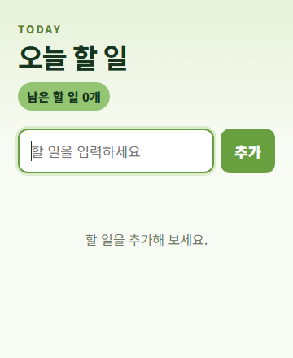

# 오늘 할 일 작성기

## 한 줄 소개

크롬 팝업에서 오늘 할 일을 추가하고 완료 여부를 관리하는 작은 할 일 목록입니다.

## 누구를 위해 만들었나요

브라우저로 작업하면서 오늘 해야 할 일을 빠르게 적고 확인하고 싶은 사람을 위해 만들었습니다.

## 주요 기능

- 할 일 추가·삭제와 완료 체크, 남은 할 일 개수 표시
- 완료하지 않은 일을 위에, 완료한 일을 아래에 표시
- 브라우저 로컬 저장소에 목록을 저장하여 팝업을 다시 열어도 유지

## 화면

## 강사 예시에서 바꾼 점

- 초록색 계열의 배경과 버튼, 큰 글자로 화면을 구성했습니다.
- 완료된 할 일이 목록 아래로 내려가도록 정렬했습니다.

## 써 보는 법

1. `chrome://extensions`에서 개발자 모드를 켜고, 압축해제된 확장 프로그램 로드로 이 폴더를 선택합니다.
2. 확장프로그램 아이콘을 누르고 할 일을 입력한 뒤 추가 버튼이나 Enter를 누릅니다.
3. 완료한 일은 체크하고 필요 없는 일은 × 버튼으로 삭제합니다.

## 다음에 붙이고 싶은 기능

- 개선 후보: 할 일별 마감일과 중요도 표시

## 만들면서 배운 점

이 코드에서는 `chrome.storage.local`로 목록을 보관하고, 완료 여부에 따라 표시 순서를 나누는 방법을 확인할 수 있습니다.
