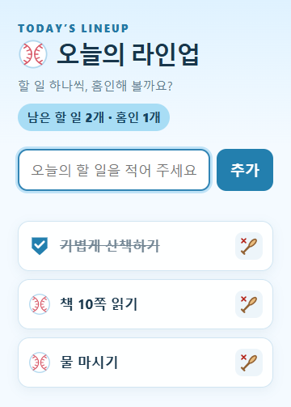

# 소문섭

## 한 줄 소개

야구 라인업처럼 오늘의 할 일을 등록하고, 하나씩 완료하며 홈인하는 투두리스트 확장프로그램입니다.

## 누구를 위해 만들었나요

아침에 오늘 할 일을 간단히 정리하고, 하루 동안 완료 여부를 확인하고 싶은 사람을 위해 만들었습니다.

## 주요 기능

- 할 일을 입력해 라인업에 추가하고 필요 없는 항목을 삭제합니다.
- 야구공을 누르면 홈 모양으로 바뀌며 완료 표시하고, 남은 할 일과 홈인한 개수를 보여 줍니다.
- 할 일과 완료 상태를 크롬 로컬 저장소에 보관해 다시 열어도 유지합니다.

## 화면

## 강사 예시에서 바꾼 점

- 화면을 하늘색 테마와 야구 라인업 콘셉트로 바꿨습니다.
- 완료 체크는 야구공·홈 아이콘으로, 삭제 버튼은 야구 배트 아이콘으로 표현했습니다.
- 남은 할 일과 완료한 할 일을 ‘남은 할 일 · 홈인’으로 표시했습니다.
- 확장프로그램 아이콘과 야구 테마 안내 문구를 추가했습니다.

## 써 보는 법

1. 크롬의 `chrome://extensions`에서 개발자 모드를 켜고 이 폴더를 ‘압축해제된 확장 프로그램 로드’로 선택합니다.
2. 확장프로그램 아이콘을 누르고 할 일을 입력한 뒤 ‘추가’를 누릅니다.
3. 끝낸 일은 왼쪽 야구공을 눌러 홈인 처리하고, 삭제하려면 오른쪽 배트 버튼을 누릅니다.

## 다음에 붙이고 싶은 기능

- 할 일별 마감일과 우선순위 표시
- 하루 단위 완료 기록 보기

## 만들면서 배운 점

화면의 색상·문구·아이콘을 함께 바꾸면 같은 할 일 관리 기능도 다른 분위기로 표현할 수 있습니다. 크롬 로컬 저장소에 목록과 완료 상태를 함께 저장해 팝업을 닫아도 이어서 사용할 수 있도록 구성했습니다.
