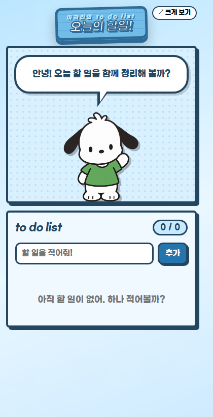

# 오늘의 할일! — 아라라의 to do list

## 한 줄 소개

하늘색 화면에서 캐릭터 아라라와 할 일을 정리하고, 완료하면 칭찬받는 투두리스트입니다.

## 누구를 위해 만들었나요

아침에 오늘 할 일을 적고, 하나씩 끝내면서 즐겁게 하루를 보내고 싶은 사람을 위해 만들었습니다.

## 주요 기능

- 할 일 추가·삭제, 완료 확인과 되돌리기, 완료 개수 표시
- 할 일을 캐릭터 말풍선으로 안내하고, 완료하면 칭찬과 캐릭터 동작 표시
- 목록 자동 저장, 공백 입력 방지, 새 탭에서 크게 보기

## 화면

## 강사 예시에서 바꾼 점

- 캐릭터를 포차코 이미지로 바꾸고, 화면에서 부르는 이름을 아라라로 변경했습니다.
- 전체 배경과 간판, 버튼을 하늘색 계열로 통일했습니다.
- 목록 제목을 to do list로, 상단 문구를 아라라의 to do list로 변경했습니다.

## 써 보는 법

1. Chrome 또는 Edge 확장 프로그램 관리에서 개발자 모드를 켜고 이 폴더를 압축해제된 확장 프로그램으로 로드합니다.
2. 확장 프로그램을 열어 할 일을 입력하고 추가를 누릅니다. 확인을 누르면 완료되며, 되돌리기와 삭제도 가능합니다.
3. 크게 보기를 누르면 새 탭에서 사용할 수 있습니다. 목록은 같은 브라우저의 로컬 저장소에 보관됩니다.

## 다음에 붙이고 싶은 기능

- 개선 아이디어: 마감 시간과 알림 기능

## 만들면서 배운 점

캐릭터 이미지와 화면 문구, 배경 색을 각각 바꾸어 원하는 분위기를 만들 수 있었습니다. 할 일 목록은 로컬 저장소를 사용해 보관합니다.
