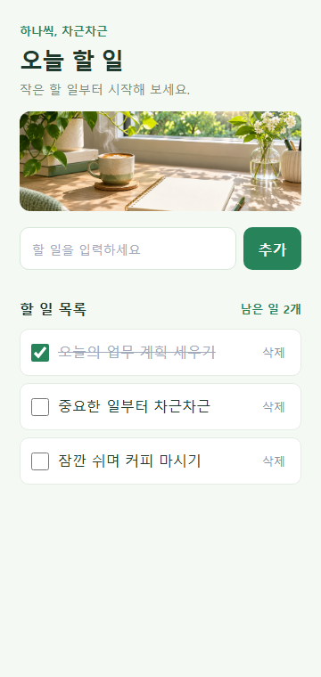

# 오늘 할 일 작성기

## 한 줄 소개

오늘 할 일을 적고 완료 여부를 체크하며 남은 일을 확인하는 크롬 확장 프로그램입니다.

## 누구를 위해 만들었나요

오늘의 업무를 간편하게 정리하고 싶은 사람을 위해 만들었습니다.

## 주요 기능

- 할 일 추가, 완료 체크 및 삭제
- 완료하지 않은 할 일 개수 표시
- 목록을 저장해 다시 열어도 유지

## 화면

## 강사 예시에서 바꾼 점

- 초록색 디자인과 햇살이 비치는 책상 사진을 넣었습니다.

## 써 보는 법

1. 크롬 확장 프로그램 관리 화면에서 이 폴더를 로드합니다.
2. 확장 프로그램을 열어 할 일을 추가하고 완료하면 체크합니다.

## 다음에 붙이고 싶은 기능

- 마감일을 표시하는 기능

## 만들면서 배운 점

크롬 확장 프로그램에서 할 일을 저장하고 화면을 꾸미는 방법을 살펴봤습니다.
