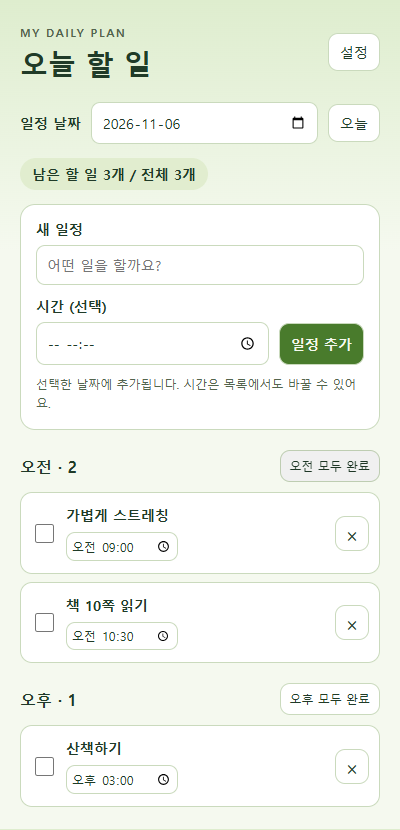
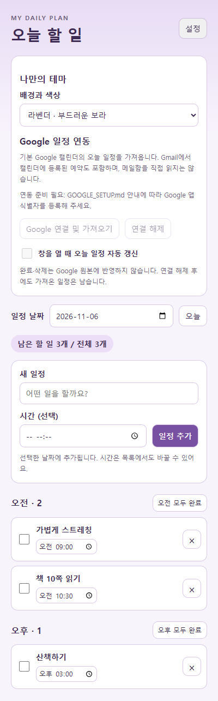

# 오늘 할 일 작성기

제출 닉네임: 홍성문 · 1라운드

## 한 줄 소개

날짜와 시간을 지정해 일정을 관리하고, 오전·오후 일괄 완료와 테마 설정을 지원하는 투두리스트입니다.

## 누구를 위해 만들었나요

하루 일정을 시간대별로 정리하고 끝낸 일을 빠르게 체크하고 싶은 사람을 위해 만들었습니다.

## 주요 기능

- 날짜·시간을 선택해 일정을 추가하고 목록에서도 시간을 수정합니다.
- 오전·오후·시간 미정으로 분류하고 그룹별 모두 완료와 완료 해제를 지원합니다.
- 할 일 추가·완료·삭제·남은 개수 표시와 자동 저장을 지원합니다.
- 숲·바다·라벤더·노을·밤의 다섯 가지 테마를 선택합니다.
- Google 캘린더의 오늘 일정 가져오기 기능이 있습니다. 별도 OAuth 앱 설정이 필요하며 기본 제출본의 연결 버튼은 비활성화되어 있습니다.

## 화면

개인정보가 없는 예시 일정으로 촬영했습니다.

## 강사 예시에서 바꾼 점

- 날짜와 시간 입력, 시간대별 그룹과 그룹 일괄 완료를 추가했습니다.
- 다섯 가지 테마와 날짜별 목록 조회를 추가했습니다.
- Google 일정 가져오기를 위한 연결 흐름과 중복 방지 처리를 추가했습니다.

## 써 보는 법

1. `chrome://extensions`에서 개발자 모드를 켜고 이 폴더를 압축해제된 확장 프로그램으로 로드합니다.
2. 날짜를 선택하고 일정 내용과 시간을 입력해 추가합니다. 오전·오후 모두 완료 버튼으로 한 번에 체크합니다.
3. 설정 버튼에서 테마를 선택합니다. Google 연동은 `GOOGLE_SETUP.md`에 따라 본인의 OAuth 앱 식별자를 설정합니다.

Google 원본 일정은 완료·삭제해도 변경되지 않습니다. 메일함을 직접 읽지 않습니다. 일정과 테마는 로컬 저장소에 보관됩니다.

## 다음에 붙이고 싶은 기능

- 일정 검색과 알림

## 만들면서 배운 점

일정의 날짜·시간대별 분류, 그룹별 완료 처리와 테마 설정을 로컬 저장소에 유지하는 방법을 실습했습니다.
