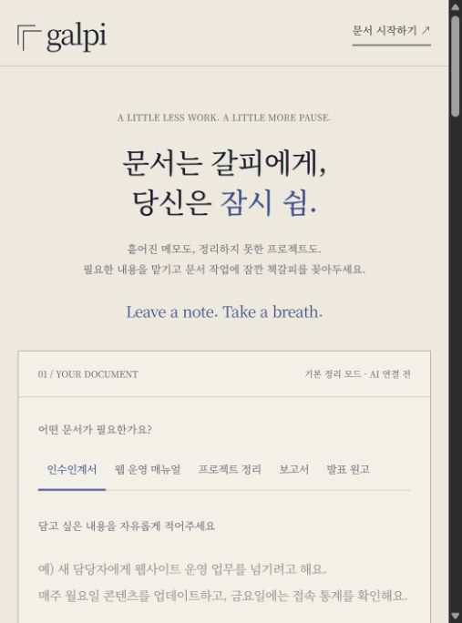

# 갈피 홈페이지

## 한 줄 소개
문서 작업의 부담을 덜어 사용자가 잠시 쉬어갈 수 있도록 돕는 5명 팀의 문서 작업 페이지입니다.

## 누구를 위해 만들었나요
공식 문서를 작성해야 하지만 시간이 부족하거나 빈 문서부터 시작하기 막막한 사내 직원을 위해 만들었습니다. 필요한 문서 유형을 고르고 내용을 입력해 초안을 정리할 수 있습니다.

## 페이지 구성
- 갈피 로고와 상단 메뉴
- 문서는 갈피에게, 당신은 잠시 쉼: 서비스 소개
- 문서 유형 선택과 내용·제목·목적·독자 입력 폼
- 기본 정리 초안 미리보기와 직접 수정·TXT 저장·PDF 인쇄
- 제작 가능한 문서 5종 안내
- 세 단계 이용 방법
- 갈피 팀과 브랜드 소개
- 자주 묻는 질문

## 배포 주소
https://galpiweb1106-2wk5.vercel.app/

## 화면

## 만들면서 배운 점
기획서로 대상 사용자와 기능을 정하고, 책갈피와 쉼의 의미를 로고에 담았습니다. 종이색·먹색 디자인에 맞춰 한글을 지원하는 명조체로 글꼴을 통일하고 입력 폼을 다듬었습니다.

현재는 입력 내용을 문서 구조에 배치하는 기본 정리 모드입니다. 실제 AI 재작성, 회사 템플릿 적용, Word/PPTX 출력, 문서 공유 링크는 향후 기능이며 현재 구현으로 표시하지 않았습니다. PDF는 브라우저 인쇄 창의 PDF 저장 기능을 이용합니다.
