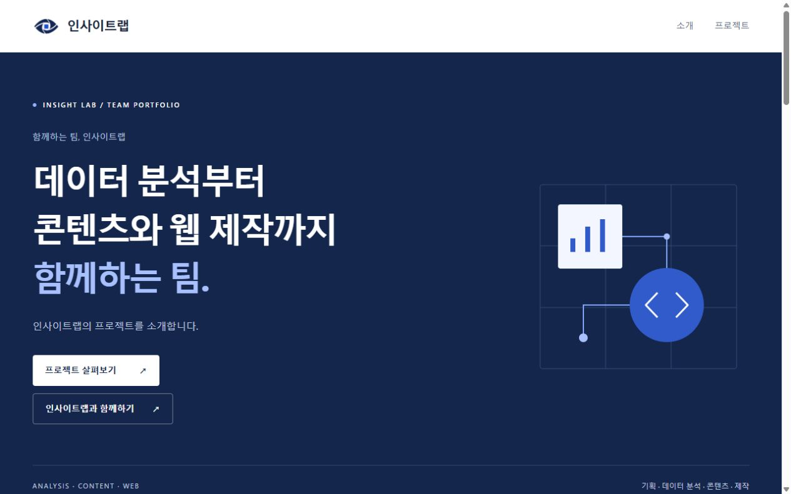

# 인사이트랩 홈페이지

## 한 줄 소개

데이터 분석부터 콘텐츠와 웹 제작까지 함께하는 팀, 인사이트랩입니다.

## 누구를 위해 만들었나요

수업 동료·강사와 함께할 팀·파트너가 팀의 역할과 프로젝트를 이해하고, 협업 가능성을 살펴볼 수 있도록 만들었습니다.

## 페이지 구성

- 팀 이름·한 줄 소개와 프로젝트 이동 버튼
- 가상 홈페이지 리뉴얼 프로젝트 5개와 AI 생성 콘셉트 이미지
- 인사이트랩과 함께하기 버튼과 문의 작성 팝업
- 팀 로고·저작권 표시·맨 위로 이동

## 배포 주소

https://webexstart.vercel.app/

## 화면

## 만들면서 배운 점

PRD로 범위와 화면 순서를 정하고 HTML·CSS·JS를 한 파일로 구성했습니다. 프로젝트 내용과 이미지는 학습용 가상 사례임을 명확히 표시했습니다. 휴대폰 화면에서 가로 넘침과 메뉴·문의 팝업 동작을 확인했습니다.

문의 팝업은 제목·내용·이름·이메일·휴대폰을 입력하고 내용을 복사할 수 있습니다. 실제 문의 전송과 수신처 연결은 [준비 필요]입니다. 로그인·데이터베이스는 사용하지 않습니다.
