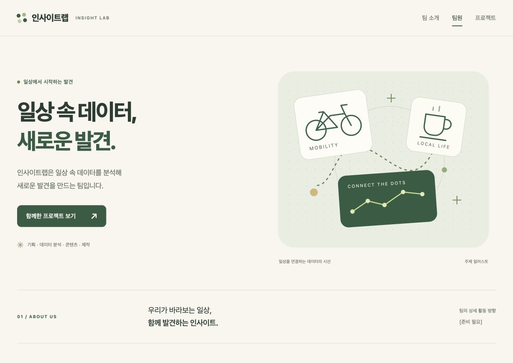

# 인사이트랩 팀 홈페이지

과제제출 · round2 · chicony

## 한 줄 소개

인사이트랩은 일상 속 데이터를 분석해 새로운 발견을 만드는 팀입니다.

## 누구를 위해 만들었나요

데이터 분석에 관심 있는 사람이 인사이트랩이 어떤 팀인지 이해할 수 있도록 만들었습니다.

## 페이지 구성

- 상단 메뉴: 팀 소개·팀원·프로젝트로 이동
- 팀 소개: 팀 이름과 한 줄 소개
- 팀원: 활빈당수(기획), 광산 노동자(데이터 분석), 돌팔이 의사(콘텐츠), 훈장(제작)
- 프로젝트: 따릉이 대여 패턴 분석, 우리 동네 카페 지도
- 하단: 팀 이름과 처음으로 이동하는 링크

## 배포 주소

아직 배포하지 않았습니다. 사용자 요청에 따라 이번에는 배포를 진행하지 않으며 배포 주소도 게시하지 않습니다.

라운드2 안내의 필수 항목인 Vercel 배포 주소는 포함하지 않은 제출본입니다.

## 화면

## 만들면서 배운 점

PRD에서 팀 소개·팀원·프로젝트 구성을 정한 뒤 HTML/CSS/JavaScript로 구현했습니다. 화면 크기에 따라 카드 배치와 메뉴가 바뀌도록 만들었습니다. 프로젝트의 실제 분석 결과 등 확정되지 않은 내용은 [준비 필요]로 표시했습니다.

## 파일과 실행 방법

- `prd.md`: 함께 작성한 기획서와 제출 시 배포 범위 변경 사항
- `logo.svg`: 홈페이지의 네 점 로고를 별도 이미지 파일로 정리한 로고
- `index.html`, `styles.css`, `script.js`: 홈페이지 코드
- `screenshot.jpg`: 제작한 홈페이지의 실제 첫 화면 캡처

위 파일들을 같은 폴더에 내려받고 `index.html`을 브라우저에서 열면 됩니다. 추가 설치, 로그인, 데이터베이스는 필요하지 않습니다.

제작 시 너비 320px·390px·1200px에서 가로 넘침 여부와 모바일 메뉴 열기·닫기, 섹션 이동을 확인했습니다. 크림색 배경·초록색 포인트·둥근 카드로 구성했습니다.

참고한 예시: `[강사예시]/03_팀-소개-페이지/index.html`, `prd.md`. 강사 예시 파일과 다른 수강생 폴더는 변경하지 않았습니다.
