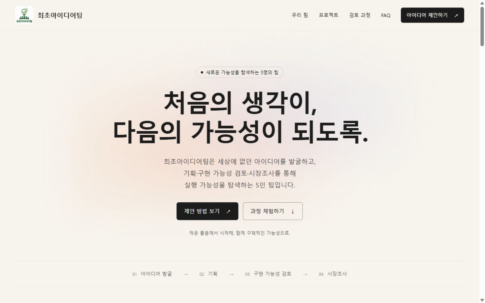
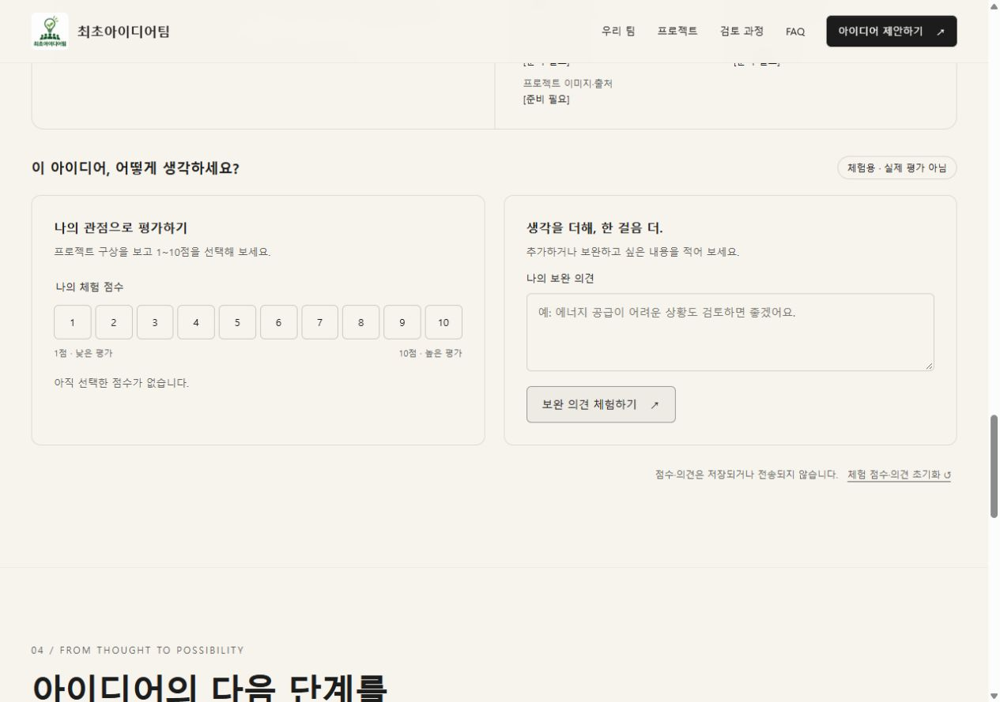
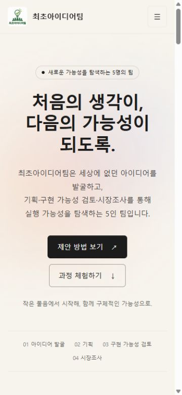

# 최초아이디어팀 홈페이지

## 한 줄 소개

최초아이디어팀은 세상에 없던 아이디어를 발굴하고, 기획·구현 가능성 검토·시장조사를 통해 실행 가능성을 탐색하는 5인 팀입니다.

## 누구를 위해 만들었나요

전체 구성원에게 아이디어 제안 방법을 안내하고, 경영진·리더에게 평가·보완·승인 과정을 체험 화면으로 보여 주기 위해 만들었습니다.

## 페이지 구성

- 첫 화면: 팀 한 줄 소개, 제안 방법과 과정 체험 버튼
- 팀 소개: 팀원 5명의 닉네임과 역할
- 아이디어 제안 안내·작성 체험: 필수 4개와 선택 2개 항목, 미리보기
- 해저 도시 프로젝트 소개 및 1~10점 평가·보완 의견 체험
- 진행 단계·구현 승인·비용 협업 부서 지정 체험
- 자주 묻는 질문

## 배포 주소

https://home-page-j7yi.vercel.app/

## 화면

## 만들면서 배운 점

PRD로 목적과 기능 범위를 먼저 정리하고 HTML·CSS·JS를 분리했습니다. 휴대폰에서 한 열 배치와 접이식 메뉴를 적용했고, 입력란은 16px로 조정했습니다. 실제 업무 처리와 화면 체험을 구분하며, 미확인 정보는 [준비 필요]로 표시했습니다.

입력과 체험 결과는 전송·저장되지 않으며 새로고침하면 사라집니다. 로그인·데이터베이스·실제 승인·부서 배정은 구현하지 않았습니다.

제출 닉네임: ggoosing5-cpu (round1과 동일)

소스 저장소: https://github.com/ggoosing5-cpu/home-page

설치 없이 이 폴더의 index.html을 더블클릭하면 열립니다. style.css, script.js, images/logo.png의 위치를 유지해 주세요.
