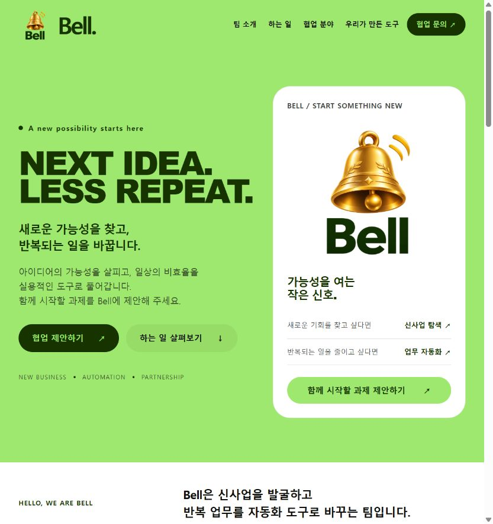

# Bell 팀 소개 홈페이지

제출 닉네임: **lth1213** · 2라운드

## 한 줄 소개
신사업을 발굴하고 반복 업무를 자동화 도구로 바꾸는 가상 팀 Bell의 소개 홈페이지입니다.

## 누구를 위해 만들었나요
Bell 팀의 역할과 협업 분야를 이해하고 협업을 제안하려는 외부 파트너를 위한 페이지입니다.

## 주요 기능
- 팀 소개, 업무 4개, 협업 분야, 도구 준비 중, 문의 안내를 한 페이지에 구성했습니다.
- 메뉴와 협업 제안 버튼으로 관련 섹션에 이동합니다.
- 휴대폰 화면에서는 모바일 메뉴와 한 열 카드로 표시합니다.
- 확장 프로그램 아이콘을 클릭하면 홈페이지가 새 탭으로 열립니다. 별도 접근 권한을 요청하지 않습니다.

## 화면

## 이번 라운드에서 만든 점
- 1라운드의 할 일 작성기·메일 정리함과 별도로 팀 소개 홈페이지를 제작했습니다.
- 인터뷰를 통해 기획서, 로고 프롬프트, 제작 계획서를 작성했습니다.
- 디자인 문서를 적용해 라임색·숲색 테마, 굵은 제목, 둥근 카드를 구성했습니다.
- 이미지 생성 도구로 만든 투명 배경 입체 골든벨 로고를 헤더와 첫 화면에 적용했습니다.
- 데스크톱 및 375px 휴대폰 폭에서 가로 넘침, 이미지 표시, 메뉴 이동을 확인했습니다.

## 사용 방법
1. 이 폴더를 로컬에 내려받습니다.
2. Chrome에서 `chrome://extensions`에 접속해 개발자 모드를 켭니다.
3. **압축해제된 확장 프로그램 로드**에서 이 `lth1213` 폴더를 선택합니다.
4. 확장 프로그램 아이콘을 클릭하면 Bell 홈페이지가 새 탭으로 열립니다.

`index.html`을 더블클릭해서 일반 홈페이지로 볼 수도 있습니다. 배포 서버나 빌드 도구는 필요하지 않습니다.

## 참고
- 가상 팀과 예시 콘텐츠로 구성했습니다. 문의 주소는 실제 접수용이 아니며 문의 전송 기능이 없습니다.
- 홈페이지의 화면과 메뉴는 브라우저로 확인했습니다. 확장 프로그램 설치 및 아이콘 클릭은 실제 Chrome에서 추가 확인이 필요합니다.
- 전용 디자인 글꼴 파일은 제공되지 않아 설치된 시스템 글꼴로 대체합니다.

## 파일
- `index.html`: 홈페이지, CSS·JS 포함
- `images/logo.png`: 투명 배경 로고
- `manifest.json`, `background.js`: 크롬에서 홈페이지를 여는 실행 구성
- `screenshot.png`: 제출용 화면
- `prd.md`, `build-plan.md`, `logo-prompt.md`: 기획·제작 문서
