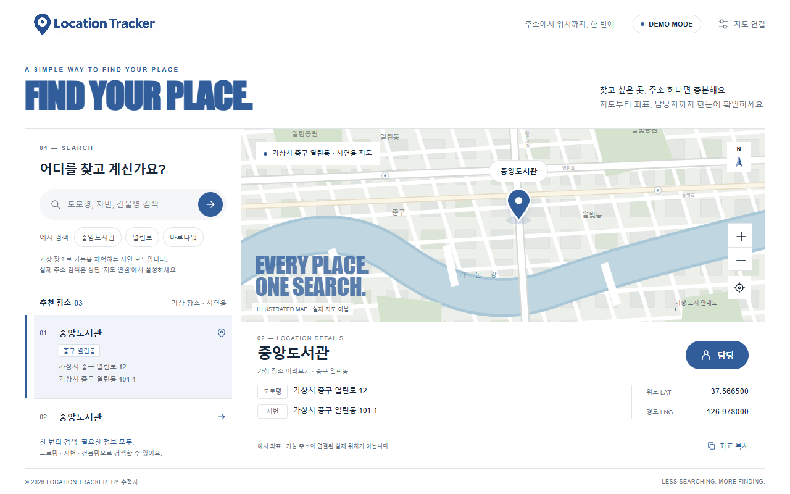
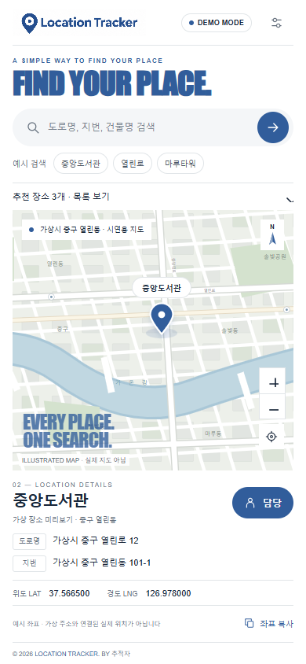
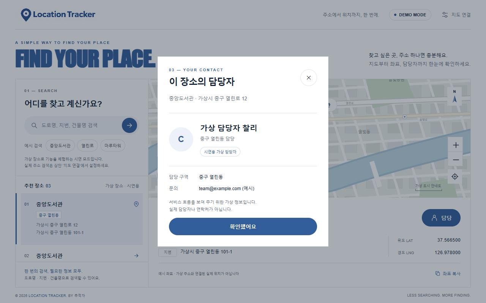

# Location Tracker — 추적자

**제작 닉네임: ppunchi · 2라운드 제출 · 버전 2.0.0**

## 한 줄 소개

도로명·지번·건물명으로 장소를 검색하고 지도 핀, 전체 주소, 위도·경도와 가상 담당자를 한 화면에서 확인하는 주소 검색 홈페이지입니다.

## 누구를 위해 만들었나요

주소로 위치를 확인하거나 같은 이름의 여러 건물을 구분하고 싶은 일반 사용자를 위해 만들었습니다. ‘추적자’라는 1인 팀의 도구이며, 입력한 주소에 해당하는 장소를 찾는 서비스입니다.

## 주요 기능

- **주소 검색과 결과 구분:** 도로명·지번·건물명을 입력하고, 여러 결과의 지역과 주소 키워드를 비교해 장소를 선택합니다.
- **한 화면 위치 확인:** 지도 핀, 도로명·지번 전체 주소, 위도·경도를 함께 표시하며 좌표를 복사할 수 있습니다. 휴대폰에서는 검색 결과 목록을 펼치고 접습니다.
- **가상 담당자와 실제 지도 연결:** ‘담당’ 버튼으로 장소별 가상 담당자를 확인합니다. 기본은 가상 데이터 시연 모드이며, 사용자가 JavaScript 키를 설정하면 Kakao 실제 지도·검색 모드로 연결합니다.

## 화면

### 데스크톱 기본 화면

검색 결과, 시연 지도, 선택한 주소와 좌표를 함께 보여 줍니다. 캡처의 모든 장소·주소·좌표는 기능 설명을 위한 예시입니다.

### 휴대폰 화면

검색·지도·주소·좌표와 담당 버튼을 한 화면에 배치하고, 결과 목록은 필요할 때 펼칩니다.

### 담당자 확인

장소에 연결된 가상 담당자와 시연용임을 명확히 표시합니다. 연락처는 예시 값입니다.

## 강사 예시에서 바꾼 점

- 팀 소개 홈페이지 기획 스킬로 요구사항을 정리하고, 소개 페이지 대신 주소 검색 도구로 구체화했습니다.
- 사용자 제공 디자인 참고 문서의 큰 영문 제목, 둥근 검색창·버튼, 얇은 구분선을 반영하고 밝은 남색을 적용했습니다.
- 영문 ‘Location Tracker’ 로고를 제작해 헤더에 적용했습니다.
- 주소별 결과 선택, 지도 핀·두 주소·좌표 표시, 장소별 가상 담당자 패널과 휴대폰 화면 구성을 추가했습니다.
- 1라운드의 할 일 작성기와 별개로 만든 2라운드 홈페이지 과제이며, 1라운드 제출본은 유지했습니다.
- GitHub Pages에 배포하고, 크롬 확장 버튼에서 배포 홈페이지를 새 탭으로 열 수 있도록 했습니다.

## 써 보는 법

### 배포 홈페이지

1. [Location Tracker 홈페이지](https://kjschaos.github.io/location-tracker/)를 엽니다.
2. ‘중앙도서관’, ‘열린로’, ‘마루타워’ 예시 버튼으로 검색합니다. 가상 주소의 일부인 ‘열린동 108-2’처럼 입력해도 됩니다.
3. 결과 목록에서 장소를 선택하고 지도 핀·주소·좌표를 확인합니다. ‘담당’ 버튼을 누르면 가상 담당자가 나옵니다.

기본 시연 모드에는 API 키가 필요 없습니다. 임의의 실제 주소는 시연 데이터에 없으므로 검색되지 않습니다. 예시 좌표와 안내도는 가상 주소에 대응하는 실제 위치가 아닙니다.

### 크롬 확장으로 열기

1. 크롬의 `chrome://extensions`에서 개발자 모드를 켭니다.
2. ‘압축해제된 확장 프로그램을 로드합니다’에서 이 저장소의 `round2/ppunchi` 폴더를 선택합니다.
3. 확장 프로그램의 Location Tracker 버튼을 누르면 배포 홈페이지가 일반 새 탭에서 열립니다. 인터넷 연결이 필요합니다.

이 확장은 홈페이지 실행용입니다. 위치·저장소·탭 조회 같은 별도 권한을 요청하지 않습니다. 홈페이지 자체를 확장 내부에서 실행하지 않으므로 지도 SDK 및 인라인 스크립트에 대한 확장 보안 정책 문제를 피합니다.

### 로컬 홈페이지

`index.html`을 더블클릭하면 예시 모드로 볼 수 있습니다. 실제 지도는 이 폴더에서 `node serve.cjs`를 실행하고 `http://localhost:4173`으로 접속합니다. Node.js가 필요하며 종료는 Ctrl+C입니다.

### 실제 주소 검색

1. [Kakao 공식 가이드](https://apis.map.kakao.com/web/guide/)에 따라 앱·지도 이용 설정과 JavaScript 키를 준비합니다.
2. JavaScript SDK 허용 도메인에 배포 사이트는 `https://kjschaos.github.io`, 로컬은 `http://localhost:4173`을 등록합니다.
3. 홈페이지의 ‘지도 연결’에 JavaScript 키를 입력합니다. REST 키는 사용하지 않습니다.

키는 제출 파일에 포함하지 않았으며, 페이지를 연 동안 메모리에서만 사용합니다. 새로고침하면 예시 모드로 돌아옵니다. 실제 모드에서는 검색어가 Kakao로 전달됩니다.

### 확인한 내용과 현재 제한

- 브라우저에서 예시 검색, 결과 선택, 주소·좌표·담당자 연결과 모바일 한 화면 구성을 확인했습니다.
- 실제 API 연결 코드는 모의 SDK로 주소 보완·추가 결과·이전 응답 무시·오류 처리를 확인했습니다.
- 실제 Kakao 키를 이용한 실서비스 검색은 아직 검증하지 않았습니다.
- 긴 주소, 글자 확대, 가로 화면이나 키보드가 열린 상태에서는 정보가 잘리지 않도록 세로 스크롤을 허용합니다.

### 파일 구성

| 파일 | 역할 |
|---|---|
| `manifest.json` | 과제 갤러리 메타데이터와 크롬 확장 설정 |
| `background.js` | 확장 버튼으로 배포 홈페이지 열기 |
| `index.html` | CSS·JavaScript가 포함된 홈페이지 원본 |
| `images/logo.png` | 제작한 영문 로고 |
| `prd.md` | 제품 기획서 |
| `logo-prompt.md` | 로고 제작 프롬프트 |
| `build-plan.md` | 제작 계획과 검증 결과 |
| `serve.cjs` | 로컬 HTTP 서버 |
| `screenshot.png` | 데스크톱 대표 화면 |
| `screenshot-2.png` | 모바일 화면 |
| `screenshot-3.png` | 가상 담당자 화면 |

## 다음에 붙이고 싶은 기능

- 실제 지도 키 설정 후 다양한 지역의 도로명·지번·건물명 검색 검증
- 담당자 목록을 관리하고 지역별 매핑을 수정하는 화면
- 검색 결과의 주소도 함께 복사하는 기능

위 항목은 향후 개선 아이디어이며 현재 제출본의 추가 구현을 의미하지 않습니다.

## 만들면서 배운 점

하나의 건물명으로 여러 장소가 나올 때는 검색 결과에 지역과 주소가 함께 있어야 올바르게 선택할 수 있다는 점을 배웠습니다. 지도 핀, 주소, 좌표와 담당자를 하나의 선택 상태에 연결하고 오래된 검색 응답을 무시해야 화면의 정보가 서로 어긋나지 않습니다.

또한 모바일에서는 모든 결과와 상세 정보를 동시에 축소하기보다 목록을 필요할 때 펼치도록 해야 핵심 정보를 읽기 쉽게 유지할 수 있었습니다. 실제 지도 연결에는 키와 도메인 설정이 필요하므로, 시연 모드와 실제 모드를 구분해 안내했습니다.
