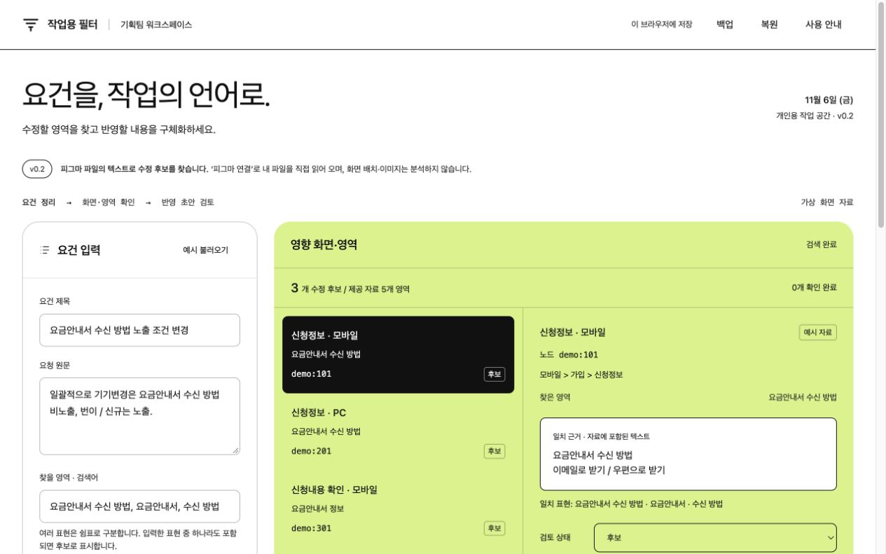

# 기획팀 작업용 필터

## 한 줄 소개

들어온 요건을 정리하고 화면별 수정 영역과 반영 초안을 구체화하는 기획자용 작업 도구입니다.

## 누구를 위해 만들었나요

요건이 들어올 때 관련 화면을 찾고, 가입 유형별 조건을 정리해 작업 지시를 작성하는 기획자를 위해 만들었습니다.

## 페이지 구성

- 요건 입력: 제목·요청 원문·검색어 및 화면 자료 준비
- 영향 화면·영역: 일치한 텍스트와 노드별 근거 확인, 검토 상태 관리
- 반영 초안: 가입 유형별 노출 조건 편집, 초안 생성·복사·저장
- 공통 도구: 피그마 연결 및 JSON 자료 가져오기, 작업 백업·복원

## 배포 주소

https://yooseonghyun-m35z.vercel.app/

## 화면

## 만들면서 배운 점

요건을 화면 탐색, 조건표, 작업 초안으로 나누어 구체화했습니다. Figma 스타일의 흰 배경·검정 버튼·라임색 결과 영역을 적용했고, 검토 상태와 초안의 저장 및 백업·복원 흐름을 확인했습니다. 텍스트 검색 후보와 실제 화면 검증을 구분하는 것이 중요했습니다.

제출물은 웹페이지입니다. `index.html`을 브라우저에서 열어 사용할 수 있습니다. 피그마 내보내기 플러그인의 소스는 이번 홈페이지 제출본에 포함하지 않았습니다. 예시 화면은 모두 가상 자료입니다.
