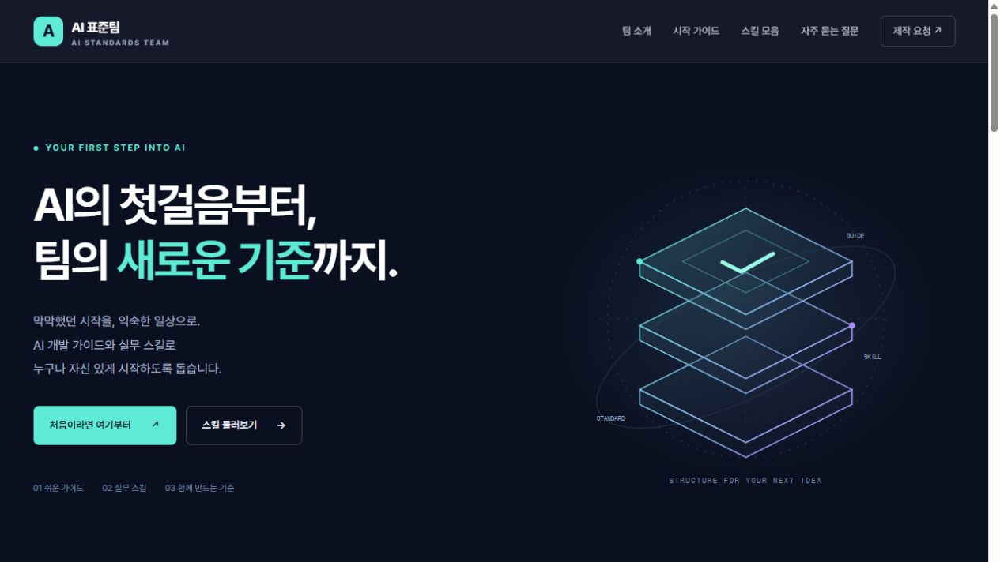

# AI 표준팀 홈페이지

## 한 줄 소개

AI 개발 가이드와 실무 스킬을 설계해, AI를 처음 사용하는 직원의 첫걸음을 돕는 팀입니다.

## 누구를 위해 만들었나요

AI를 처음 사용하는 직원이 개발 가이드를 확인하고, 필요한 스킬의 사용 예시를 찾아보며, 새로운 가이드·스킬 제작 요청문을 작성할 수 있도록 만들었습니다.

## 페이지 구성

- 첫 화면: 팀 소개 문구와 ‘처음이라면 여기부터’, ‘스킬 둘러보기’ 버튼
- 팀 소개: 개발 가이드, 실무 스킬, 안전한 사용 기준을 설계하는 역할
- 시작 가이드: AI 도구 시작하기, 프롬프트 작성법, 안전한 정보 입력, 결과 검토
- 스킬 모음: 문서 작성·회의록 정리·자료 요약의 검색·분류와 사용 예시
- 제작 요청: 요청 유형·불편한 점·원하는 결과를 입력해 요청문 생성·복사
- FAQ: 설치·사용 방법, 결과 개선, 정보 입력 주의사항, 새 스킬 요청 안내

스킬 파일은 ‘준비 중’이며, 제작 요청은 자동 전송 없이 요청문을 복사하는 방식입니다. 로고는 홈페이지에서 사용하는 ‘A’ 임시 글자 로고를 SVG 파일로 함께 제출합니다.

## 배포 주소

https://sktedu-team-page.vercel.app/

## 화면

## 만들면서 배운 점

team-page-prd 스킬로 대상 사용자와 필요한 기능을 먼저 정리하고, 기획서와 제작 계획을 홈페이지로 구현했습니다. HTML·CSS·JavaScript만으로 검색·분류와 요청문 복사 기능을 구성하고, 모바일 메뉴와 반응형 화면을 설계했습니다. 실제 제공되는 기능과 ‘준비 중’인 기능을 구분하고, GitHub와 Vercel을 통해 웹페이지를 배포하는 흐름을 익혔습니다.
