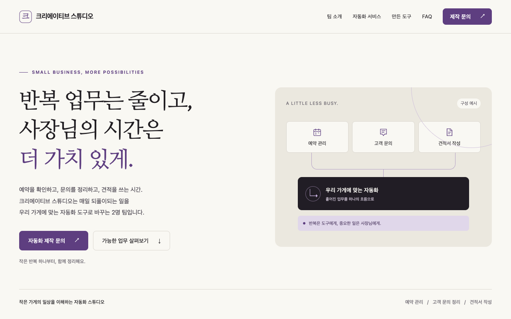

# 크리에이티브 스튜디오 홈페이지

## 한 줄 소개

소상공인의 반복 업무를 자동화 도구로 바꾸는 2명 팀입니다.

## 누구를 위해 만들었나요

자동화가 필요한 소상공인을 위해 만들었습니다. 제공 서비스를 살펴보고 자동화 제작을 문의할 수 있도록 구성했습니다. 실제 문의 채널은 준비 중입니다.

## 페이지 구성

- 팀 소개: 팀의 역할과 자동화 업무 흐름 구성 예시
- 자동화 서비스: 예약 관리, 고객 문의 정리, 견적서 작성
- 만든 도구: 준비 중 카드
- FAQ: 자동화 가능한 업무와 제작 기간 안내
- 제작 문의: 문의 준비 항목과 문구 복사 기능

## 배포 주소

https://homepagedesign01.vercel.app/

## 화면

## 만들면서 배운 점

PRD로 대상 사용자와 필요한 내용을 정리하고, 이를 한 장짜리 반응형 홈페이지로 구현했습니다. 디자인 참고 문서의 크림색 배경과 명조체 제목을 팀의 보라색에 맞게 적용했으며, 모바일 메뉴와 문의 문구 복사 기능을 확인했습니다.
