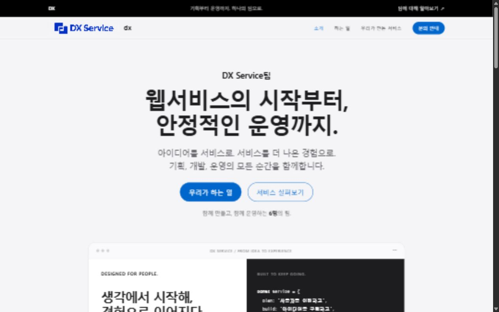

# DX Service팀 홈페이지

## 한 줄 소개

웹서비스를 기획하고 개발하며 안정적인 운영과 지속적인 개선을 이어가는 6명 팀의 소개 홈페이지입니다.

## 누구를 위해 만들었나요

누구나 방문해서 DX Service팀이 어떤 일을 하는지 쉽게 이해할 수 있도록 만들었습니다. 비개발자도 읽을 수 있도록 업무 설명과 예시를 함께 제공합니다.

## 페이지 구성

- 팀 소개: 한 줄 소개, 6명 팀 안내, 주요 섹션 바로가기
- 하는 일: 웹서비스 기획, 프론트엔드 개발, 백엔드 개발, 서비스 운영, 장애 대응, 서비스 개선
- 우리가 만든 서비스: 준비 중 안내
- 문의 안내: 예시 채널과 이메일, 응답 시간 추후 안내

## 배포 주소

https://teampage-self.vercel.app/

## 화면

## 만들면서 배운 점

대화로 요구사항을 정리해 PRD와 제작 계획서를 작성하고, 이를 바탕으로 반응형 홈페이지를 만들었습니다. 참고 디자인 문서의 색상·글꼴·여백·버튼 규칙을 적용하고, 로고 생성 프롬프트로 만든 이미지를 헤더에 연결했습니다.

홈페이지 소스 저장소: https://github.com/5Suminsss2/team_page

`index.html`을 브라우저에서 직접 열어도 확인할 수 있습니다. 문의 정보는 예시이며 전송 기능은 연결되어 있지 않습니다.
