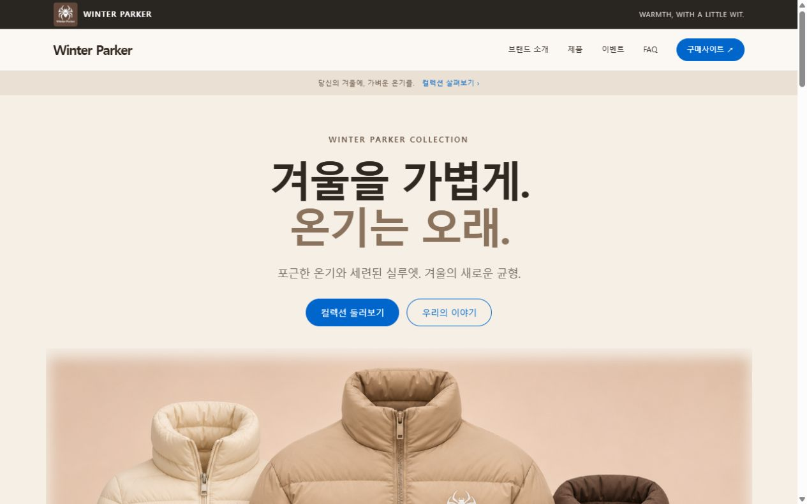

# Winter Parker 팀 홈페이지

## 한 줄 소개

겨울을 따뜻하게 보낼 패딩을 만드는 5인 팀 Winter Parker의 브랜드 소개와 제품 탐색 홈페이지입니다.

## 누구를 위해 만들었나요

패딩을 구매하려는 고객이 브랜드를 이해하고 남성용·여성용·키즈용 제품 콘셉트를 살펴본 뒤, 외부 판매처에서 실제 상품과 가격을 확인할 수 있도록 만들었습니다.

## 페이지 구성

- 메인: 겨울을 가볍게, 온기는 오래 — 세 패딩이 겹치는 컬렉션 이미지
- 제품의 방향: 경량성·보온성·생활 방수
- 제품: 남성용·여성용·키즈용 분류와 각각 한 벌씩 제작한 이미지
- 브랜드 소개: 이름에 담긴 이야기와 리코딩(팀장)·오리털·거위털·토끼털·여우털 소개
- 이벤트: 준비 중 안내
- FAQ: 보온성·충전재·세탁법·생활 방수 안내
- 구매사이트: 유니클로의 실제 남성·여성·키즈 상품 상세로 이동

## 배포 주소

https://winterparkereg.vercel.app/

## 화면

## 만들면서 배운 점

기획서를 바탕으로 방문자와 구매 동선을 먼저 정하고, 애플 스타일의 넓은 여백과 큰 제품 이미지에 따뜻한 베이지 색상을 조합했습니다. 로고를 패딩의 같은 가슴 위치에 적용하고, 남성·여성·키즈 제품은 단독 이미지를 각각 만든 뒤 메인에서 겹쳐 보이게 구성했습니다. 모바일 메뉴·제품 필터·FAQ 동작을 확인하고 GitHub 업로드와 실제 웹 배포가 서로 다른 단계라는 점을 배웠습니다.

제출 닉네임: 리코딩. Winter Parker는 연습용 가상 브랜드이며, 제품 이미지는 AI로 제작한 콘셉트입니다. 연결한 외부 상품은 별도 판매처의 제품입니다. 로컬에서는 index.html을 더블클릭하면 열립니다.
