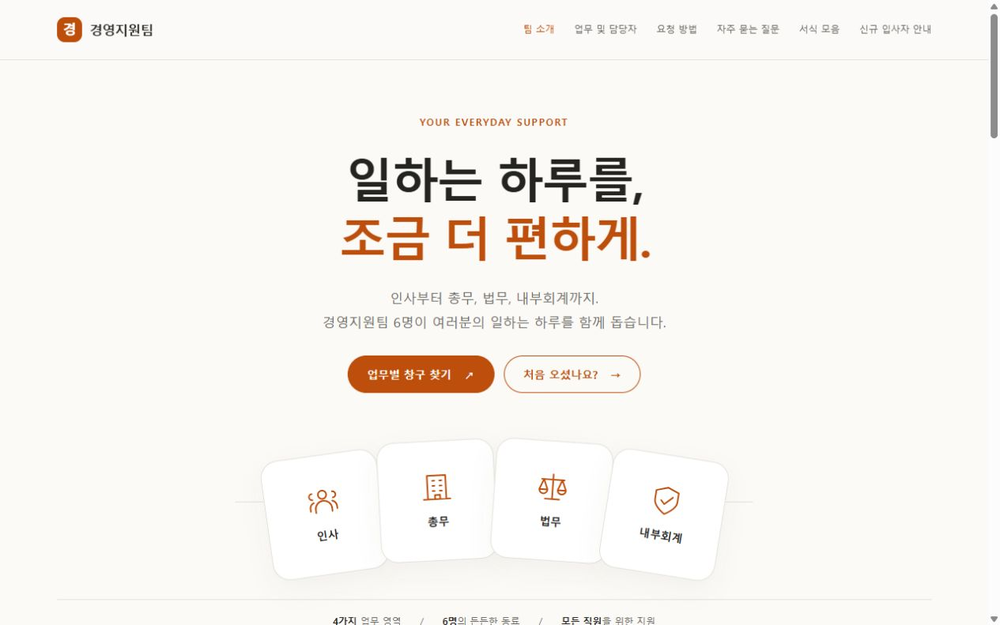

# 경영지원팀 홈페이지

## 한 줄 소개

인사·총무·법무·내부회계를 담당하는 가상의 6명 팀을 소개하고, 업무별 담당 창구와 요청 방법을 안내하는 홈페이지입니다.

## 누구를 위해 만들었나요

전 직원과 신규 입사자를 가정한 수업용 페이지입니다. 방문자가 필요한 업무를 찾고, 담당 창구와 어떤 요청을 할 수 있는지 쉽게 확인하도록 만들었습니다. ‘경영지원팀’은 연습용 가상 팀 이름이며 실제 회사의 조직 정보가 아닙니다.

## 페이지 구성

- 팀 소개: 한 줄 소개와 4가지 담당 업무, 6명 팀 안내
- 업무 및 담당자: 인사·총무·법무·내부회계별 대표 요청과 담당 창구
- 요청 방법: 업무 선택, 요청 내용 정리, 창구 확인
- 자주 묻는 질문: 업무 선택·요청 준비·서식·입사자 안내
- 서식 모음: 업무별 자료 자리와 준비 중 표시
- 신규 입사자 안내: 인사·총무 업무로 바로 이동

## 배포 주소

https://homepage-iota-pied.vercel.app/

## 화면

## 만들면서 배운 점

대화로 팀의 역할과 방문 목적을 정리해 기획서를 작성하고, 이를 바탕으로 한 장짜리 홈페이지를 제작했습니다. 참고 디자인 문서의 넓은 여백과 큰 제목을 활용하면서 주황색 강조와 업무별 안내 구조로 목적에 맞게 바꿨습니다. 자료와 연락 경로가 없는 부분은 ‘준비 중’으로 구분했습니다.

제출 로고는 홈페이지에 사용한 주황색 ‘경’ 임시 글자 로고를 SVG 파일로 정리한 것입니다. 연락처는 예시 값만 사용하며 실제 접수 기능은 없습니다.
