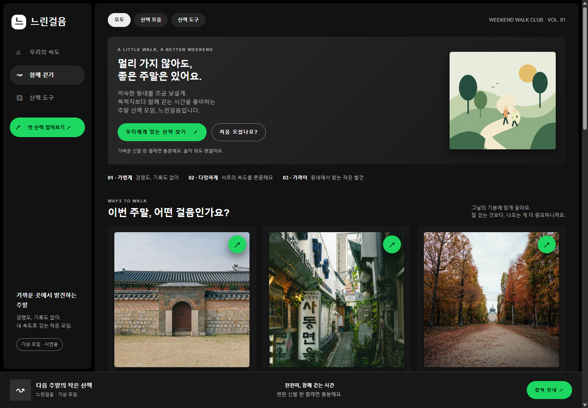
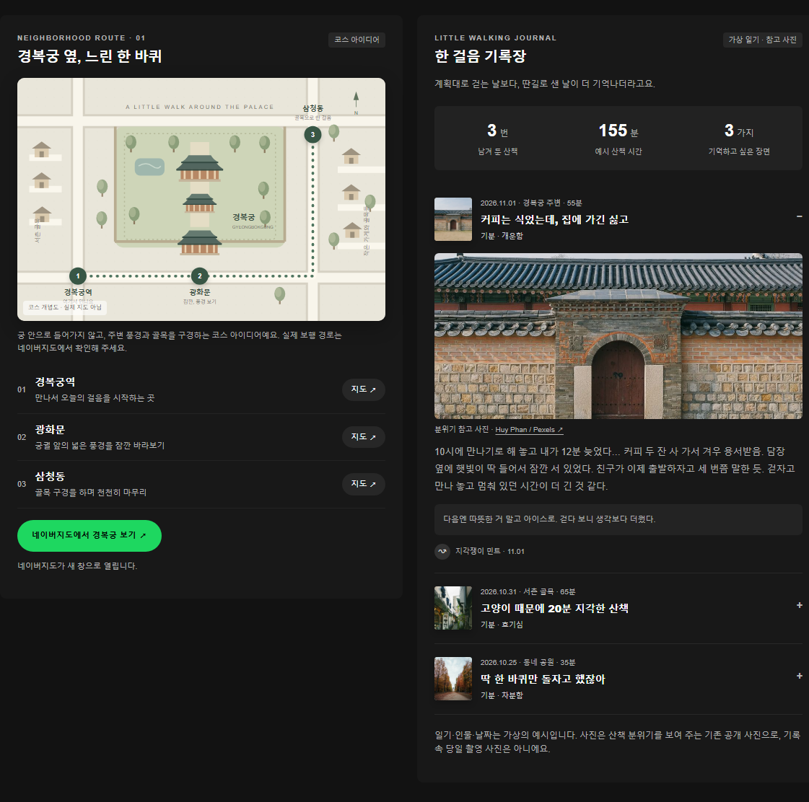
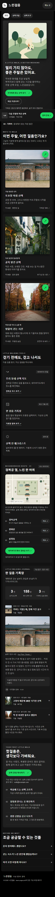

# 느린걸음 — 주말 산책 모임

## 한 줄 소개

산책 활동과 경복궁 주변 코스, 산책 기록을 소개하는 주말 산책 모임 페이지입니다.

## 누구를 위해 만들었나요

주말에 가볍게 걷고 싶은 사람이 모임의 분위기와 활동을 살펴보고, 자신에게 맞는 산책을 고를 수 있도록 만들었습니다.

## 페이지 구성

- 모임 소개와 산책 원칙
- 토요일 아침 산책, 골목 발견 산책, 말없이 걷는 시간
- 산책 지도·기록장·체크리스트 안내
- 경복궁 주변 코스 개념도와 장소별 네이버지도 링크
- 사진과 함께 펼쳐 보는 예시 산책 기록
- 참여 안내와 자주 묻는 질문

## 배포 주소

https://esemyu.vercel.app/

## 화면

## 만들면서 배운 점

기획한 내용을 메뉴와 카드로 구성하고, 화면 크기에 따라 배치를 조정하는 방법을 익혔습니다. 지도 링크와 사진, 접었다 펼치는 기록을 추가하며 페이지의 내용을 구체화했습니다.
