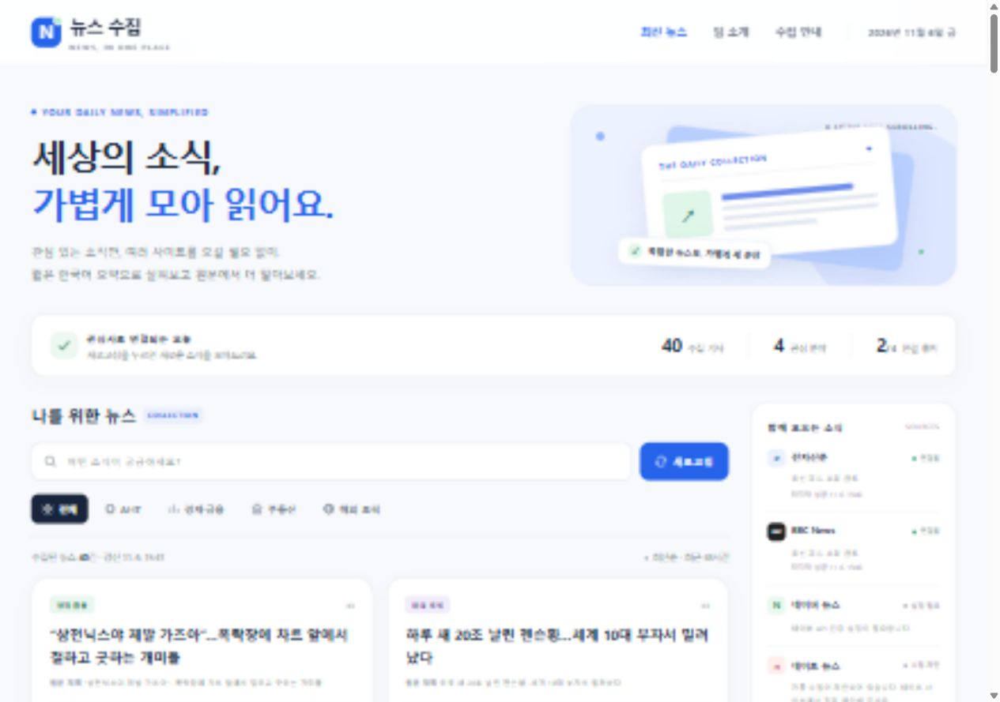

# 뉴스 수집

## 한 줄 소개

AI·IT, 경제·금융, 부동산, 해외 토픽 뉴스를 한곳에 모아 한국어 요약과 원문 링크를 제공하는 팀의 뉴스 서비스입니다.

## 누구를 위해 만들었나요

특정 분야의 뉴스를 찾는 사람이 여러 사이트를 오가는 시간을 줄이고, 관심 분야의 요약을 읽은 뒤 원문으로 이동할 수 있도록 만들었습니다.

## 페이지 구성

- 뉴스 수집 로고와 상단 메뉴
- 서비스 한 줄 소개와 수집 현황
- 키워드 검색, 분야 선택, 새로고침
- 기사 제목·원문 제목·한국어 요약·매체·시각·원문 링크를 담은 뉴스 카드
- 수집처별 연결 상태와 수집 안내
- 팀 소개와 예시 문의 정보

## 배포 주소

https://team-page-fawn.vercel.app/

## 화면

## 만들면서 배운 점

화면 구현과 실제 뉴스 수집 서버를 나누고, 출처별 연결 실패·요약 근거 부족·API 미설정 상태를 구분하는 방식으로 만들었습니다. 모바일 화면과 키워드·분야 필터, 소수점 수치 보존을 확인했습니다.

실행 방법과 연동 범위는 [RUNNING.md](RUNNING.md), 검증 내역은 [verification.md](verification.md)에 있습니다. BBC·전자신문 RSS 수집을 확인했으며, 네이버 인증과 AI 요약은 별도 키 설정이 필요합니다. 네이트 자동 수집은 현재 제한 상태입니다.
