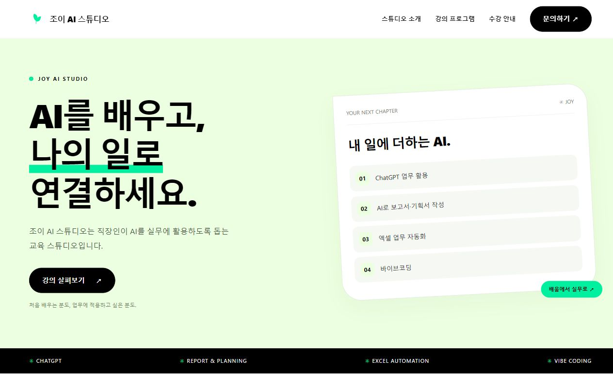

# 조이 AI 스튜디오

## 한 줄 소개
직장인이 AI를 실무에 활용하도록 돕는 교육 스튜디오입니다.

## 누구를 위해 만들었나요
AI 입문자와 AI를 사용해 봤지만 업무 적용이 어려운 직장인이 자신에게 맞는 강의를 찾도록 만들었습니다.

## 페이지 구성
- 첫 소개와 강의 살펴보기
- 스튜디오 소개와 운영자 조이 소개
- ChatGPT 업무 활용·보고서 및 기획서 작성·엑셀 업무 자동화·바이브코딩 강의 안내
- 온라인·오프라인 수강 안내
- 이메일 신청·문의 안내 (이메일 주소는 [준비 필요])

## 배포 주소
https://onbuilding.vercel.app/

## 화면

## 만들면서 배운 점
[준비 필요]
