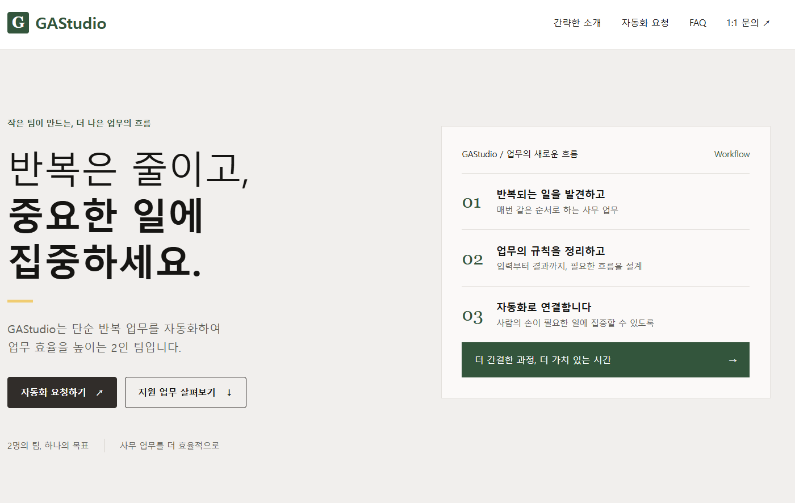

# GAStudio 팀 홈페이지

## 한 줄 소개

단순 반복 업무를 자동화하여 업무 효율을 높이는 2인 팀입니다.

## 누구를 위해 만들었나요

사무 업무를 주로 하는 부서가 자동화 가능한 업무를 살펴보고 요청 초안을 준비할 수 있도록 만들었습니다.

## 페이지 구성

- 간략한 팀 소개
- 자동화 업무 예시: 엑셀 데이터 정리, 간단한 문서 작성, 대량 메일 발송
- 우리가 만든 도구: 준비 중
- 자동화 요청 초안 작성과 복사
- FAQ
- 1:1 문의 초안 작성과 복사

## 배포 주소

https://lrc-ten-peach.vercel.app/

## 화면

## 만들면서 배운 점

팀의 목적과 대상 사용자를 PRD로 정리하고 홈페이지에 반영했습니다. 확장 프로그램에서도 동작하도록 JavaScript를 별도 파일로 분리했습니다.

## 실행 방법

- 웹페이지: index.html을 브라우저에서 엽니다.
- 크롬 확장 프로그램: chrome://extensions에서 개발자 모드를 켜고 이 폴더를 로드한 뒤 확장 프로그램 아이콘을 누릅니다.
- logo.svg는 초록색 G 임시 로고입니다.
