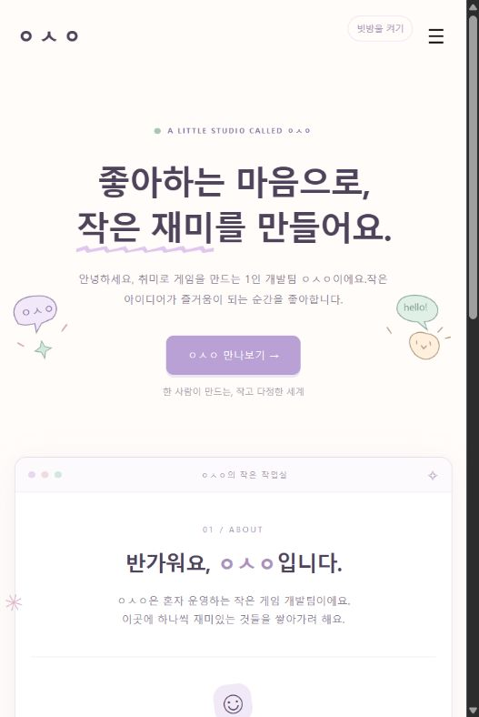

# ㅇㅅㅇ — 작은 게임 개발팀

## 한 줄 소개
취미로 게임을 만드는 1인 팀 ㅇㅅㅇ의 파스텔톤 소개 홈페이지입니다.

## 누구를 위해 만들었나요
팀과 앞으로 만들 게임에 관심 있는 방문자를 위해 만들었습니다.

## 주요 기능
- 중앙 제목, 손그림 장식, 브라우저 창 형태의 소개 영역을 반응형으로 구성했습니다.
- 페이지에 들어오면 빗방울이 자동으로 떨어지고 작은 그릇을 좌우로 움직일 수 있습니다.
- 비 100개를 받으면 폭죽과 ‘대단해요!’가 잠깐 나타난 뒤 게임만 종료됩니다.
- 오른쪽 위에서 빗방울을 끄거나 다시 켤 수 있습니다.

## 화면

## 강사 예시에서 바꾼 점
- 1라운드의 할 일 작성기와 별도로, 팀 홈페이지 PRD 스킬을 활용한 새 프로젝트를 만들었습니다.
- 참고 이미지를 바탕으로 중앙 정렬과 넓은 여백을 적용하고 파스텔 색감과 얼굴 글자 로고를 넣었습니다.
- 소개 화면을 유지하면서 실행되는 미니게임을 추가했습니다.
- 수업 제출 형식에 맞춰 아이콘 클릭으로 소개 페이지를 여는 확장 프로그램으로 포장했습니다.

## 써 보는 법
1. Chrome의 chrome://extensions에서 개발자 모드를 켜고 이 폴더를 ‘압축해제된 확장 프로그램 로드’로 선택합니다.
2. 확장 프로그램 아이콘을 누르면 소개 페이지가 새 탭에서 열립니다. 또는 index.html을 브라우저로 직접 열어도 됩니다.
3. PC는 좌우 방향키, 모바일은 하단 좌우 버튼으로 그릇을 움직입니다. 오른쪽 위에서 비를 끄고 켤 수 있습니다.

홈페이지 원본: https://github.com/hongseongmun/Tema_Ace

## 다음에 붙이고 싶은 기능
- 직접 만든 게임을 소개하고 플레이할 수 있는 작품 목록

## 만들면서 배운 점
대화로 기획서를 만들고 참고 이미지에 맞춰 디자인을 수정하는 과정, 애니메이션의 충돌 판정과 종료 처리, 확장 프로그램의 스크립트 분리 방식을 실습했습니다.
